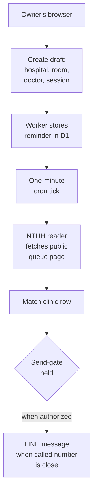

# Next is you

> Watches a hospital queue page and sends a LINE reminder when your number is almost up.

[English](README.md) · [繁體中文](README.zh-TW.md)

## What this is

A visit to a large hospital in Taiwan often means waiting several hours for your number to be called. A family member sits in the waiting room while the rest of the family stays elsewhere, hoping to arrive just in time. The light-number board moves at its own pace, so the only honest way to know when to leave is to keep refreshing the queue page by hand. NTU Hospital's ophthalmology department is where this problem bites first, but the shape is the same at any large hospital in Taiwan that publishes a queue page.

Next is you is a small private tool that does that watching. The owner opens a stable URL in a browser, drafts today's visit (hospital, department, room, doctor, session), and presses Start. A Cloudflare Worker then reads the public registration-progress page on a schedule, matches the clinic card, and - when the current number is close - sends one LINE message to the recipients the owner has invited.

It is a tool for one family and the people they invite, not a public service. Reminders stay held across every environment until the owner's own handset pilot (Issue #22) explicitly authorizes a real send.

If you are looking at this repository for the first time and wondering whether you could run your own copy: yes, that is a supported path. Jump to [For other families (self-hosting)](#for-other-families-self-hosting) for the prerequisites and scope, then [For developers](#for-developers) for the local setup.

## Status

Honest status as of today. The GitHub tracker is the authoritative source. Nothing in this list means a real patient reminder has been delivered.

**Done**

- [x] Private HTTPS service deployed with reminders held, held bootstrap only - [#18](https://github.com/KLTsai/next-is-you/issues/18)
- [x] Clinic matching by department + doctor + room, with the watch bounded by the live source's own first/blank reads instead of a hardcoded session clock window - [#34](https://github.com/KLTsai/next-is-you/issues/34)
- [x] Cascading reminder-setup UI: hospital, department, and date drive a live doctor/room dropdown (session auto-derived), falling back to manual entry with pre-submit validation when no roster is available - [#47](https://github.com/KLTsai/next-is-you/issues/47). The synthetic-hospital degradation path is proven in a browser: the current-number-only half ([#104](https://github.com/KLTsai/next-is-you/issues/104)), and the unsupported-hospital state and the fallback to manual entry after a failed clinic schedule read ([#116](https://github.com/KLTsai/next-is-you/issues/116)). Frontend unit tests cover the form logic ([#115](https://github.com/KLTsai/next-is-you/issues/115)). Known gap: the mismatch check only runs when a roster is available (manual entry relies solely on backend Start validation, by design).
- [x] Pre-flight validation blocks three setup mistakes before monitoring starts: past visit date, selected doctor not working on the chosen date, department/doctor/room combination that does not match NTUH's own schedule (today both doctor cases are reported as the same `doctor_not_scheduled` refusal; telling them apart is tracked separately). Future dates within NTUH's 14-day window are validated against the dept-wide schedule; drafts beyond that are held and re-validated by a daily sweep once the hospital publishes their day - [#58](https://github.com/KLTsai/next-is-you/issues/58)
- [x] Reusable hospital-adapter backend boundary (`HospitalReader` interface, hospital registry, capability descriptor) and a documented hospital-integration guide ([docs/ADDING-A-HOSPITAL.md](docs/ADDING-A-HOSPITAL.md)) - [#45](https://github.com/KLTsai/next-is-you/issues/45). The interface, registry, guide, clinic-schedule rules and matching inside each reader, the current-number-only Start path, and a setup page and database that name no hospital have shipped, and a test scans the frontend source for every registered hospital's id and display name. The registry contract test is in place. The issue is closed with every acceptance item ticked. Evidence is fixture and local automated only; live NTUH behavior stays with [#20](https://github.com/KLTsai/next-is-you/issues/20).

**In progress**

- [ ] Making Staging, then Production, live: the gates in [docs/PRE-LIVE-CHECKLIST.md](docs/PRE-LIVE-CHECKLIST.md) - [#129](https://github.com/KLTsai/next-is-you/issues/129)
- [ ] Owner's handset pilot (first real reminder). It also owns the live checks left by the closed [#19](https://github.com/KLTsai/next-is-you/issues/19) (own-account LINE walkthrough) and [#20](https://github.com/KLTsai/next-is-you/issues/20) (first genuine read compared with the room), and replaces [#21](https://github.com/KLTsai/next-is-you/issues/21) - [#22](https://github.com/KLTsai/next-is-you/issues/22)

**Future direction** (planned, not committed)

- [ ] Additional hospitals and departments beyond NTU main-campus ophthalmology. Structural discovery (departments, doctors, consultation rooms, URL patterns) can be automated via browsing or retrieval; each new hospital still needs one in-person verification comparing the public page's current-number against the physical room-light, plus human confirmation of ambiguous field semantics and hospital reuse terms.
- [ ] Frontend UI/UX redesign using a mainstream industry web framework (examples: React, Vue, Svelte, or comparable). The current frontend ships as-is; no framework has been chosen.
- [ ] Repository governance hardening: CodeQL scanning, branch protection, issue/PR templates, CODEOWNERS, and SECURITY.md. This work has not started; the design is still being considered, with no date or implementation commitment. It is separate from the deployment pipeline, which is already in place, including its pinned actions and their Dependabot updates - see [docs/CI-CD.md](docs/CI-CD.md).

The Status section is the single place that describes what works today versus what is being built; features gated behind an open issue are not claimed anywhere else in this document.

## How it works



The reader stores only the matched row's fields (room, doctor, clinic type, current number and the link to its page) for the clinic the owner's draft names, and what that clinic's own progress page states, including the status of every patient number still on its list. The reader drops its copy when the day ends. Raw response bodies are not retained. Each environment is either live or not live, from a committed value (see [Making an environment live](#making-an-environment-live)). No environment is live today, so none reads a hospital or emits a real LINE message.

### Notification rules

These are the rules the design uses once live operation is authorized by the [Issue #22 pilot](https://github.com/KLTsai/next-is-you/issues/22). Today the service does not poll the live hospital or send real LINE messages; the rules describe the intended behavior. Authoritative detail lives in [docs/NTUH-READER.md](docs/NTUH-READER.md) and [docs/HTTPS-SERVICE.md](docs/HTTPS-SERVICE.md).

- **Polling cadence.** A one-minute scheduler tick offers the reader a chance to check; each clinic is read at most once every 2 minutes (the cadence in the NTUH reader guide). An observation is considered fresh for up to 2 minutes. Transient failures retry at 1, 2, then 4 minutes; a server `Retry-After` is honored up to a 10-minute cap.
- **Appointment day only.** Reads happen on the appointment day only, as described in [docs/NTUH-READER.md](docs/NTUH-READER.md). A clinic that is not listed sends no progress reminder. After 23:59 Taipei time on the appointment date the reminder expires with no further notice.
- **Trigger condition.** A near reminder is eligible when the called current number is 1 to 3 numbers before the owner's number (the near window is distance `1..3`).
- **Repeat near reminders ([#33](https://github.com/KLTsai/next-is-you/issues/33), merged).** Entering the near window, moving forward or backward inside it, or re-entering after a backward move all qualify, because only equality to the previous scheduled read suppresses a reminder. The message text is identical for every repeat.
- **Per-visit cap.** Each recipient receives at most 20 near reminders per logical visit (`NEAR_REMINDER_CAP = 20`). Only non-superseded reminders count toward the cap; a superseded unsent reminder does not consume cap budget. A newer unsent near reminder supersedes an older unsent one for the same recipient.
- **Deduplication and retry identity.** Each near-send event is persisted with a stable retry identity before the LINE request, so the same logical event never accepts a second send and the identity is stable across restarts.

### Known limitations

This is a convenience reminder, not a safety-critical system. The clinic room's physical light indicator remains authoritative. Read these edges before relying on the service.

- **Only one visit can run at a time.** While a visit is monitoring (or stopping), Start on another draft is refused with a link to the running visit. Stop the running visit first, then press Start again. This keeps each scheduler tick inside the Cloudflare Free plan's CPU limit; allowing more needs the tick split per visit (ADR 0005).
- **The hospital page can change at any time.** NTUH may alter the queue page's layout without notice, and the reader may stop producing usable data until the owner adapts it. The service does not identify layout changes specifically; after three consecutive unusable reads, it sends the existing generic unavailable reminder.
- **Not for emergency or safety-critical reminders.** LINE outages, home or carrier network loss, Cloudflare incidents, or a halted Worker all fail silently. There is no out-of-band alarm when sends stop.
- **A late reminder can arrive for a passed number.** If a clinic session ends earlier than usual, the service may send one last reminder for a number that has already been called.
- **No per-recipient tuning.** Every recipient in a family receives the same message. There are no custom time windows, no quiet hours, and no priority ordering between recipients.
- **The room's physical light is authoritative.** The hospital page value may lag the room by minutes. Arrive early enough to confirm by the clinic room's own display; the project's reader doc records that NTUH itself states the physical indicator is authoritative (see [docs/NTUH-READER.md](docs/NTUH-READER.md)).
- **A reminder is a "get moving" signal, not proof the number has been called.** The reminder exists so the family does not have to keep refreshing the page or watching the phone; it means the called number is close and it is time to head toward the clinic. On arrival, the room's own display shows exactly which number is up - the brief, natural check anyone makes walking into a clinic.

## For the owner (daily use)

Daily use is browser-only. The owner's stable origin is a fixed `workers.dev` URL recorded privately during the first-time deployment. It moves if the Cloudflare account's `workers.dev` subdomain changes, which has happened once, so re-bookmark from the `PROD_WORKER_URL` repository variable rather than trusting an older bookmark.

1. Open the stable URL in any browser.
2. Create a draft for today's visit.
3. Press **Start**.
4. Close the browser. Once live operation is authorized, the service will continue watching the queue on its one-minute schedule.

If the owner also joined as a family member with the same LINE account, signing in with LINE again without an invitation link returns to the organizer view.

Today, pressing Start initiates neither live hospital queue reads nor live LINE reminder sends; both remain held pending the [Issue #22 pilot](https://github.com/KLTsai/next-is-you/issues/22). The flow above describes the intended behavior once the pilot authorizes live operation.

To stop or hold:

- **Stop a reminder**: in the UI, open the active reminder and confirm **停止追蹤**. A notification already in flight may settle before Stop confirms. See the [stop and recovery notes in the HTTPS service doc](docs/HTTPS-SERVICE.md#stop-failure-recovery-and-rollback).
- **Hold the whole service** (when the system is misbehaving): the owner, signed in, sets recovery hold through the authorized status API. The exact console snippet lives in the [HTTPS service stop and recovery section](docs/HTTPS-SERVICE.md#stop-failure-recovery-and-rollback). Recovery hold survives Worker restarts and must be set before any restore or code rollback.
- **Rollback the deployment**: the captain runs **Promote** with an earlier version number, as described in the [rollback section of the CI/CD guide](docs/CI-CD.md#rollback). Rollback restores code only. If Promote itself is unusable, fall back to the native Wrangler procedure in the [stop, failure recovery and rollback section](docs/HTTPS-SERVICE.md#stop-failure-recovery-and-rollback). Either way, only roll back to a version compatible with the current schema and preserved SQLite class; rollback never reverses a D1 migration, and this README deliberately does not restate the exact commands.

First-time deployment (secrets, Login channel registration, provisioning) is a separate owner setup; see [docs/HTTPS-SERVICE.md](docs/HTTPS-SERVICE.md).

## For other families (self-hosting)

Self-hosting is a real path, with real prerequisites and a real limit on scope.

Prerequisites:

- A Cloudflare account with Workers, D1, and SQLite Durable Objects available (the held bootstrap targets the Free plan; see the [HTTPS service doc's Free-plan table](docs/HTTPS-SERVICE.md#free-plan-and-origin-decision) for the quotas it depends on).
- A LINE Developers account with a Login channel and a Messaging channel under the same provider; the owner's LINE subject (a stable identifier, not a display name) must be privately supplied.
- Your own copy of this repository.

Scope limit: the only hospital source currently supported by this project is NTU Hospital's main campus (總院區) ophthalmology (眼科), any session of the entered day, matched against the clinic cards on the official public registration-progress page. Production reads remain held pending the Issue #22 pilot. See [docs/NTUH-READER.md](docs/NTUH-READER.md) for the exact supported scope and known gaps. Adding another hospital is intended future work: structural discovery (departments, doctors, consultation rooms, URL patterns) can be automated via browsing or retrieval, but each new hospital still needs one in-person verification comparing the public page's current-number against the physical room-light, plus human confirmation of ambiguous field semantics and hospital reuse terms.

For the end-to-end owner setup sequence (local proof, Wrangler login, D1 creation, migrations, deployment, LINE callback registration, acceptance), follow [docs/HTTPS-SERVICE.md](docs/HTTPS-SERVICE.md) in order.

## For developers

Install the locked dependencies once:

```sh
npm ci
uv sync --group dev --locked
```

`npm run lint` also runs [actionlint](https://github.com/rhysd/actionlint) on `.github/workflows/` (`npm run lint:workflows`). No npm or uv package provides it, so install the binary once, at the version CI pins in the `Lint workflows (actionlint)` step of [ci.yml](.github/workflows/ci.yml) (1.7.12 today), plus [shellcheck](https://www.shellcheck.net/), which actionlint uses for `run:` scripts and silently skips when it is missing:

```sh
# Download the pinned release into the current directory, then move it onto PATH:
bash <(curl -fsSL https://raw.githubusercontent.com/rhysd/actionlint/v1.7.12/scripts/download-actionlint.bash) 1.7.12
actionlint -version
brew install shellcheck
```

`brew install actionlint` also works but installs the newest release, which may report findings CI does not. When that happens, fix them, or bump the version and checksum in `ci.yml` and the version in this section in the same change. CI uses the runner image's shellcheck, so its version follows the image.

Local entrypoints:

- **Complete local service rehearsal:** `npm run dev:rehearsal`, then open <http://127.0.0.1:8787>. Real local D1 and SQLite Durable Object bindings, synthetic login, fake providers. Needs no credentials. Follow the [complete rehearsal guide](docs/LOCAL-REHEARSAL.md) for the first synthetic setup, draft, Start/Stop, fake send, duplicate tick, and restart journey.
- **Lightweight shell smoke:** `npm run dev:local`, then open <http://127.0.0.1:8787>. UI build plus the Python ASGI app on loopback, no Cloudflare bindings. With the blank template, `curl -i http://127.0.0.1:8787/auth/line` returns `503`. Does not exercise database features or reminder sends.

Checks (install Chromium once with `uv run playwright install chromium`):

| Command | Runs | When |
| --- | --- | --- |
| `npm test` | pytest without the `browser` tests, then `npm run test:ui` | Inner loop while editing |
| `npm run test:all` | The full pytest suite, browser tests included | Before pushing a change to UI or Worker behavior |
| `npm run check` | Every CI gate in order: `lint`, `typecheck`, `test:ui`, `build`, `check:migrations`, `check:diff`, `test:all` | Before pushing; green here means the CI gates should be green |

Each gate is also its own script (`npm run lint`, `npm run typecheck`, and so on). The `browser` marker is assigned in `tests/conftest.py` to every test in a module that drives Chromium or starts a local Worker; `uv run pytest -m browser` runs only those. `check:diff` runs `scripts/check_ci_diff.sh` on the commits since `origin/main` and `git diff --check` on uncommitted changes.

These are fixture/mock and local automated evidence; they do not contact a live hospital or LINE, deploy, or prove handset delivery. See the [CI workflow](.github/workflows/ci.yml): each pull request push or push to `main` is one run with seven named gates (formatting and lint, type check, frontend tests, build, migration check, backend and browser tests, diff hygiene) and a summary of each outcome; on `main`, Release Please follows the gates. Tag pushes start no run. [docs/CI-CD.md](docs/CI-CD.md#one-change-one-run) describes it. The backend and browser tests run as four shards on separate runners (pytest-split, balanced by the committed `.test_durations`), and the one job named "Backend and browser tests" fails unless every shard succeeded.

When the shards' pytest steps drift more than about a minute apart, or after adding or removing many tests, refresh the durations from a full local run and commit the file in its own `test:` change:

```sh
uv run pytest -q --store-durations
```

Tests missing from the file are given the average duration, so a stale file only unbalances the shards; it never skips a test.

Delivery follows [docs/CI-CD.md](docs/CI-CD.md): a green push to `main` deploys staging automatically; merging the release PR makes that commit a version tagged `vX.Y.Z`; and the captain runs **Promote** with the version number to put it in production and publish its Release. Documentation-only pushes leave staging untouched, and the repository variable `STAGING_DEPLOY_PAUSED` set to `true` pauses automatic staging deployment. Only the captain merges the release PR and runs Promote.

### Making an environment live

An environment is live (`GLOSSARY.md`) when `vars.NIY_LIVE` in its own committed config (`wrangler.staging.jsonc`, `wrangler.production.jsonc`) is `"true"`. Live means it reads the hospital and sends LINE messages together; not live means it does neither, even with a LINE token present. A live environment also reads and sends nothing, Start and the clinic picker included, unless its `LINE_CHANNEL_ACCESS_TOKEN` belongs to the Official Account named by the committed `LINE_BOT_BASIC_ID`, and its status endpoint says why. Local test mode is unaffected. The value changes only through a pull request the captain merges, after that environment's gates in [docs/PRE-LIVE-CHECKLIST.md](docs/PRE-LIVE-CHECKLIST.md#how-an-environment-is-made-live) pass. **It cannot be undone:** the promote guard and the Staging deploy refuse any version older than the environment's first live one (`uv run python scripts/delivery_state.py live-check staging|production <commit>`), so no rollback through a Promote or CI run created after #237 merged makes it not live again. Re-running an older run is not checked and must not be used once an environment is live. `tests/test_live_config.py`, `tests/test_live_switch.py` and `tests/test_live_rollback.py` hold these rules.

To see where delivery stands, run `npm run status` (needs `gh` signed in and `uv`; read-only). It prints the commit on `main` and whether its checks passed, the commit staging is showing and whether it equals `main`, the version in production (the version the newest successful Promote run deployed, so a rollback shows correctly), the next proposed version with its release PR and change count, any version that is tagged but not yet a Release, and exactly one next step. If a fact cannot be read it names that fact on stderr and exits non-zero rather than printing a partial report. The rules live in `scripts/delivery_state.py` as a pure function over a snapshot of facts, tested from recorded snapshots by `tests/test_delivery_state.py` in the pytest gate above. The same module holds the promote guard: `uv run python scripts/delivery_state.py guard <version>` prints `Accepted` or one refusal reason with the action that clears it, which is exactly what the Promote workflow runs.

Linked procedures:

- [Complete rehearsal guide](docs/LOCAL-REHEARSAL.md)
- [NTUH reader guide](docs/NTUH-READER.md)
- [Pre-live checklist](docs/PRE-LIVE-CHECKLIST.md)
- [Local manual checklist](docs/NIY-020-LOCAL-MANUAL-CHECKLIST.md)
- [HTTPS service preparation](docs/HTTPS-SERVICE.md)
- [CI, staging, Promote and release pipeline](docs/CI-CD.md)
- [Deployed secrets inventory](docs/SECRETS.md)
- [Research index](research/README.md), including the [NIY-021 findings summary](research/NIY-021-findings-summary.md)
- [Issue-tracker conventions](docs/agents/issue-tracker.md); historical records are [archived](docs/archive/tickets/README.md)

Active work is tracked in [GitHub Issues](https://github.com/KLTsai/next-is-you/issues).

## Worktrees

Each session (an agent, a terminal, treehouse, or the no-mistakes pipeline) works in its own git worktree, never in a checkout another session is using. A new worktree has tracked files only: no `node_modules/`, `.venv/` or `dist/`. Bootstrap it once before running any check:

```sh
npm ci && uv sync --group dev --locked && npm run build
```

- Rerun `npm ci` or `uv sync --group dev --locked` when `package-lock.json` or `uv.lock` changes.
- `npm run dev:local`, `npm run dev:rehearsal` and the browser tests build the UI themselves. Rerun `npm run build` after changing `frontend/` when you serve `dist/` any other way, such as `pywrangler dev` or the Python app directly.
- Without `node_modules/`, `npm run typecheck` cannot find `tsc`, and every browser test that builds the UI fails at once with "This worktree is not bootstrapped".
- A worktree nested inside the main checkout, such as `.claude/worktrees/`, silently uses the main checkout's `node_modules/`, which may not match its own lockfile. Bootstrap it too.

## Scope and non-goals

Next is you is a private family tool. It will not:

- Become a public SaaS or support multi-tenant onboarding.
- Calculate ETAs, predict the next number, or estimate from anything the hospital does not state. People ahead is the one estimate, made from the numbers the hospital lists and always worded as one (GLOSSARY.md).
- Add paid-plan features, status badges that depend on external services, or marketing surfaces.

Reminder sends remain held in every environment until the owner's handset pilot ([Issue #22](https://github.com/KLTsai/next-is-you/issues/22)) explicitly authorizes a real reminder.

## Disclaimer and source access

Next is you is not an official service of any hospital and is not affiliated with one. It is a private, non-commercial family tool that charges nothing and is not offered to the public. It does not guarantee that what it reads is correct or current: the hospital's own pages and the on-site display in the clinic always take precedence, and a reminder never confirms that a number has been called.

It reads hospital pages under these rules:

- Only pages any visitor can open, at a low rate, and only the clinic a draft names.
- It never bypasses a login, CAPTCHA, consent button, identity check, or block, and it identifies itself honestly instead of disguising its client.
- It keeps no raw responses, republishes nothing, and links the owner to the hospital's official page.
- It stops reading a hospital that refuses access, and prefers official open data where a hospital publishes it.

The source research behind these rules is in [research/automated-access-taiwan-law.md](research/automated-access-taiwan-law.md) and [research/hospital-schedule-and-progress-survey.md](research/hospital-schedule-and-progress-survey.md). Neither is legal advice.

## Privacy

Next is you is designed to keep as little as it needs:

- **What is stored:** invitation records, consent records, and outbox events for scheduling and deduplication. No raw hospital response bodies are retained; the reader keeps only the matched row's fields (room, doctor, clinic type, current number and the link to its page) for the clinic the owner's draft names, and what that clinic's own progress page states, including the status of every patient number still on its list. The reader drops its copy when the day ends.
- **Appointment cutoff:** at 23:59 Taipei time on the appointment date, active reminders expire and no further notices are sent.
- **Active-data cleanup:** drafts and expired reminders are cleaned up by the first scheduled run at or after 48 hours past the 23:59 Taipei cutoff; stopped reminders, 48 hours after Stop. Cleanup also runs while sends are held. During a recovery hold only expired drafts are cleaned up; everything else waits until the hold is released.
- **Removal:** the organizer removes a member directly; there is no recipient-facing self-service withdrawal in this pass. When a member is removed, their record is erased. Someone who signs in from an invitation but does not press 確認加入 is a pending invitee: they can confirm while that sign-in lasts (four hours), and are erased after it. A new invitation works for them at any time.
- **Backups:** backup retention is tracked separately from active-data cleanup; see the [pre-live checklist](docs/PRE-LIVE-CHECKLIST.md) for the deployed storage and backup gates.

The exact mechanics live in the storage and lifecycle docs; this section states them in plain terms. The owner's stable origin is a public `workers.dev` URL whose static shell and `/api/healthz` endpoint are reachable to anyone, while organizer data and mutations require an allowlisted LINE session and CSRF.
