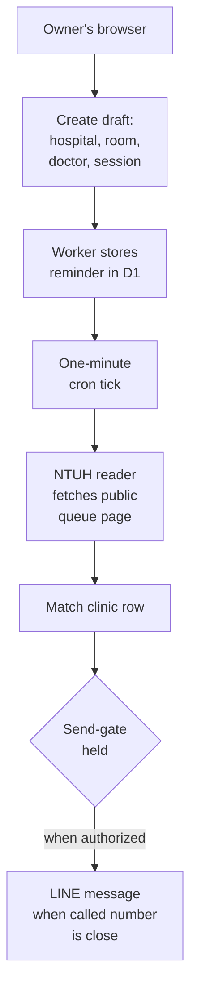

# Next is you

> Watches a hospital queue page and sends a LINE reminder when your number is almost up.

[English (current)] · [繁體中文](README.zh-TW.md)

## What this is

A visit to a large hospital in Taiwan often means waiting several hours for your number to be called. A family member sits in the waiting room while the rest of the family stays elsewhere, hoping to arrive just in time. The light-number board moves at its own pace, so the only honest way to know when to leave is to keep refreshing the queue page by hand. NTU Hospital's ophthalmology afternoon session is where this problem bites first, but the shape is the same at any large hospital in Taiwan that publishes a queue page.

Next is you is a small private tool that does that watching. The owner opens a stable URL in a browser, drafts today's visit (hospital, department, room, doctor, afternoon session), and presses Start. A Cloudflare Worker then reads the public registration-progress page on a schedule, matches the clinic row, and - when the current number is close - sends one LINE message to the recipients the owner has invited.

It is a tool for one family and the people they invite, not a public service. Reminders stay held across every environment until the owner's own handset pilot (Issue #22) explicitly authorizes a real send.

## Status

Honest status as of today. The GitHub tracker is the authoritative source. Nothing in this list means a real patient reminder has been delivered.

**Done**

- [x] Private HTTPS service deployed with reminders held, held bootstrap only - [#18](https://github.com/KLTsai/next-is-you/issues/18)

**In progress**

- [ ] LINE enrollment and withdrawal UI - [#19](https://github.com/KLTsai/next-is-you/issues/19)
- [ ] NTU ophthalmology afternoon reader: fixture and local integration evidence in place; live hospital behavior unverified - [#17](https://github.com/KLTsai/next-is-you/issues/17), [#20](https://github.com/KLTsai/next-is-you/issues/20)
- [ ] Private storage recovery and operator readiness - [#21](https://github.com/KLTsai/next-is-you/issues/21)
- [ ] Owner's handset pilot (first real reminder) - [#22](https://github.com/KLTsai/next-is-you/issues/22)

**Future direction** (planned, not committed; not tracked by an issue yet)

- [ ] Additional hospitals beyond NTU main-campus ophthalmology afternoon. Structural discovery (departments, doctors, consultation rooms, URL patterns) can be automated via browsing or retrieval; each new hospital still needs one in-person verification comparing the public page's current-number against the physical room-light, plus human confirmation of ambiguous field semantics and hospital reuse terms.
- [ ] Frontend UI/UX redesign using a mainstream industry web framework (examples: React, Vue, Svelte, or comparable). The current frontend ships as-is; no framework has been chosen.

The Status section is the single place that describes what works today versus what is being built; features gated behind an open issue are not claimed anywhere else in this document.

## How it works



The reader stores only the matched row's fields (room, doctor, clinic type, current number) for the clinic the owner's draft names. Raw response bodies are not retained. The send-gate is a per-environment hold: no environment emits a real LINE message until the Issue #22 pilot flips it, by design.

### Notification rules

These are the rules the design uses once live operation is authorized by the [Issue #22 pilot](https://github.com/KLTsai/next-is-you/issues/22). Today the service does not poll the live hospital or send real LINE messages; the rules describe the intended behavior. Authoritative detail lives in [docs/NTUH-READER.md](docs/NTUH-READER.md) and [docs/HTTPS-SERVICE.md](docs/HTTPS-SERVICE.md).

- **Polling cadence.** A one-minute cron offers the reader a chance to check; each clinic reads the official progress list at most once every 2 minutes (the owner-approved cadence in the NTUH reader guide is 2-3 minutes). An observation is considered fresh for up to 2 minutes. Transient failures retry at 1, 2, then 4 minutes; a server `Retry-After` is honored up to a 10-minute cap.
- **Appointment day only.** Reads happen within the supported session window (NTU main-campus ophthalmology afternoon: 13:30-16:30, plus 10 minutes either side). No polling before the window; a blank number with the doctor's row still present is temporary no-data; once the row disappears after the session, the clinic is marked ended and reading stops. After 23:59 Taipei time on the appointment date the reminder expires with no further notice.
- **Trigger condition.** A near reminder is eligible when the called current number is 1 to 3 numbers before the owner's number (the near window is distance `1..3`).
- **Repeat near reminders ([#33](https://github.com/KLTsai/next-is-you/issues/33), merged).** Entering the near window, moving forward or backward inside it, or re-entering after a backward move all qualify, because only equality to the previous scheduled read suppresses a reminder. The message text is identical for every repeat.
- **Per-visit cap.** Each recipient receives at most 20 near reminders per logical visit (`NEAR_REMINDER_CAP = 20`); superseded unsent reminders still count toward that cap. A newer unsent near reminder supersedes an older unsent one for the same recipient.
- **Deduplication and retry identity.** Each near-send event is persisted with a stable retry identity before the LINE request, so the same logical event never accepts a second send and the identity is stable across restarts.
- **Unavailable alert.** When reads inside the clinic window are unusable, the third consecutive unusable read triggers one "source unavailable" alert per recipient; skipped ticks, time before the window, and the clinic ending are not unusable reads.

## For the owner (daily use)

Daily use is browser-only. The owner's stable origin is a fixed `workers.dev` URL set up during the first-time deployment; use the bookmark saved during that setup.

1. Open the stable URL in any browser.
2. Create a draft for today's visit.
3. Press **Start**.
4. Close the browser. Once live operation is authorized, the service will continue watching the queue on its one-minute schedule.

Today, pressing Start initiates neither live hospital queue reads nor live LINE reminder sends; both remain held pending the [Issue #22 pilot](https://github.com/KLTsai/next-is-you/issues/22). The flow above describes the intended behavior once the pilot authorizes live operation.

To stop or hold:

- **Stop a reminder**: in the UI, open the active reminder and confirm **停止提醒**. A notification already in flight may settle before Stop confirms. See the [stop and recovery notes in the HTTPS service doc](docs/HTTPS-SERVICE.md#stop-failure-recovery-and-rollback).
- **Hold the whole service** (when the system is misbehaving): the owner, signed in, sets recovery hold through the authorized status API. The exact console snippet lives in the [HTTPS service manual acceptance section](docs/HTTPS-SERVICE.md#manual-deployed-acceptance-unrun). Recovery hold survives Worker restarts and must be set before any restore or code rollback.
- **Rollback the deployment**: use the native Wrangler rollback procedure in the [stop, failure recovery and rollback section](docs/HTTPS-SERVICE.md#stop-failure-recovery-and-rollback). Only roll back to a version compatible with the current schema and preserved SQLite class; this README deliberately does not restate the exact commands.

First-time deployment (secrets, Login channel registration, provisioning) is a separate owner setup; see [docs/HTTPS-SERVICE.md](docs/HTTPS-SERVICE.md).

## For other families (self-hosting)

Self-hosting is a real path, with real prerequisites and a real limit on scope.

Prerequisites:

- A Cloudflare account with Workers, D1, and SQLite Durable Objects available (the held bootstrap targets the Free plan; see the [HTTPS service doc's Free-plan table](docs/HTTPS-SERVICE.md#free-plan-and-origin-decision) for the quotas it depends on).
- A LINE Developers account with a Login channel and a Messaging channel under the same provider; the owner's LINE subject (a stable identifier, not a display name) must be privately supplied.
- Your own copy of this repository.

Scope limit: the only hospital source currently supported by this project is NTU Hospital's main campus (總院區) ophthalmology (眼科) afternoon session, 13:30-16:30, matched against the Dr. appointment list rows on the official public registration-progress page. Production reads remain held pending the Issue #22 pilot. See [docs/NTUH-READER.md](docs/NTUH-READER.md) for the exact supported scope and known gaps. Adding another hospital is intended future work: structural discovery (departments, doctors, consultation rooms, URL patterns) can be automated via browsing or retrieval, but each new hospital still needs one in-person verification comparing the public page's current-number against the physical room-light, plus human confirmation of ambiguous field semantics and hospital reuse terms.

For the end-to-end owner setup sequence (local proof, Wrangler login, D1 creation, migrations, deployment, LINE callback registration, acceptance), follow [docs/HTTPS-SERVICE.md](docs/HTTPS-SERVICE.md) in order.

## For developers

Install the locked dependencies once:

```sh
npm ci
uv sync --group dev --locked
```

Local entrypoints:

- **Complete local service rehearsal:** `npm run dev:rehearsal`, then open <http://127.0.0.1:8787>. Real local D1 and SQLite Durable Object bindings, synthetic login, fake providers. Needs no credentials. Follow the [complete rehearsal guide](docs/LOCAL-REHEARSAL.md) for the first synthetic setup, draft, Start/Stop, fake send, duplicate tick, and restart journey.
- **Lightweight shell smoke:** `npm run dev:local`, then open <http://127.0.0.1:8787>. UI build plus the Python ASGI app on loopback, no Cloudflare bindings. With the blank template, `curl -i http://127.0.0.1:8787/auth/line` returns `503`. Does not exercise database features or reminder sends.

CI-equivalent deterministic checks:

```sh
uv run playwright install chromium
uv run ruff format --check src tests
uv run ruff check src tests
npm run typecheck
npm run test:ui
npm run build
uv run python scripts/check_migrations.py
uv run pytest -q
git diff --check
```

These are fixture/mock and local automated evidence; they do not contact a live hospital or LINE, deploy, or prove handset delivery. See the [CI workflow](.github/workflows/ci.yml) for the gates it runs.

Linked procedures:

- [Complete rehearsal guide](docs/LOCAL-REHEARSAL.md)
- [NTUH reader guide](docs/NTUH-READER.md)
- [Pre-live checklist](docs/PRE-LIVE-CHECKLIST.md)
- [Local manual checklist](docs/NIY-020-LOCAL-MANUAL-CHECKLIST.md)
- [HTTPS service preparation](docs/HTTPS-SERVICE.md)
- [Research index](research/README.md), including the [NIY-021 findings summary](research/NIY-021-findings-summary.md)
- [Issue-tracker conventions](docs/agents/issue-tracker.md); historical records are [archived](docs/archive/tickets/README.md)

Active work is tracked in [GitHub Issues](https://github.com/KLTsai/next-is-you/issues).

## Scope and non-goals

Next is you is a private family tool. It will not:

- Become a public SaaS or support multi-tenant onboarding.
- Calculate ETAs, predict the next number, or infer the queue from neighboring rows.
- Add paid-plan features, status badges that depend on external services, or marketing surfaces.

Reminder sends remain held in every environment until the owner's handset pilot ([Issue #22](https://github.com/KLTsai/next-is-you/issues/22)) explicitly authorizes a real reminder.

## Privacy

Next is you is designed to keep as little as it needs:

- **What is stored:** invitation records, consent records, and outbox events for scheduling and deduplication. No raw hospital response bodies are retained; the reader keeps only the matched row's fields (room, doctor, clinic type, current number) for the clinic the owner's draft names.
- **Appointment cutoff:** at 23:59 Taipei time on the appointment date, active reminders expire and no further notices are sent.
- **Active-data cleanup:** drafts and expired reminders are cleaned up 48 hours after the Taipei-midnight cutoff; stopped reminders are cleaned up 48 hours after Stop.
- **Withdrawal:** when a recipient withdraws, their record is erased.
- **Backups:** backup retention is tracked separately from active-data cleanup; see the [pre-live checklist](docs/PRE-LIVE-CHECKLIST.md) for the deployed storage and backup gates.

The exact mechanics live in the storage and lifecycle docs; this section states them in plain terms. The owner's stable origin is a public `workers.dev` URL whose static shell and `/api/healthz` endpoint are reachable to anyone, while organizer data and mutations require an allowlisted LINE session and CSRF.
