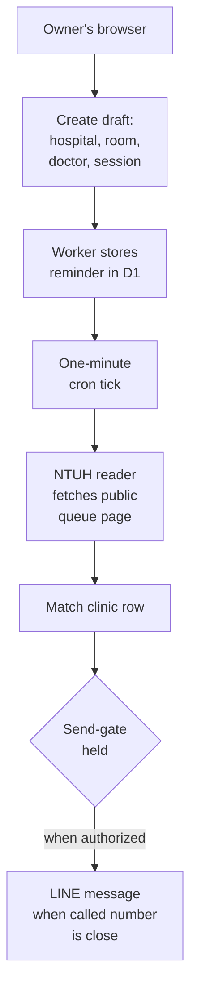

# Next is you

> 盯著醫院看診進度頁，在號碼快到時發一則 LINE 提醒給你。

[English](README.md) · [繁體中文 (當前)]

## 這是什麼

去台灣各家大醫院看診，光是等自己的號碼被叫到，常常就要耗上好幾個小時。家中一位成員在候診區守著進度，其他人則待在別處，希望能剛好趕到。看診號碼燈牌有自己的節奏，想真正知道何時該出門，誠實的辦法只有一條：自己手動一直重新整理進度頁。這個痛點最先在台大醫院眼科的下午診出現，但只要是會公告看診進度頁的大醫院，情境都差不多。

Next is you 就是替你做這件事的小工具。擁有者在瀏覽器開啟固定網址，把當天的門診資訊建成草稿（醫院、科別、診間、醫師、下午診），按下 Start。接著一個 Cloudflare Worker 會依排程讀取公開的看診進度頁，比對該門診的那一列，當目前叫號接近時，發一則 LINE 訊息給擁有者所邀請的收件人。

這是給一個家庭與他們所邀請的人使用的工具，不是公開服務。在擁有者本人透過 Issue #22 的手機實測明確授權真實發送之前，所有環境下的提醒都處於保留狀態。

## 現況

以下是今日誠實的現況。權威來源是 GitHub 上的 issue tracker。以上任何一項都不代表已經有一則真實的病患提醒被送出。

**已完成**

- [x] 私人 HTTPS 服務已部署、提醒保留中，僅為保留態 bootstrap - [#18](https://github.com/KLTsai/next-is-you/issues/18)

**進行中**

- [ ] LINE 邀請與退出 UI - [#19](https://github.com/KLTsai/next-is-you/issues/19)
- [ ] 台大眼科下午診 reader：已具備 fixture 與本地整合證據；真實醫院行為尚未驗證 - [#17](https://github.com/KLTsai/next-is-you/issues/17)、[#20](https://github.com/KLTsai/next-is-you/issues/20)
- [ ] 私人儲存復原與營運就緒 - [#21](https://github.com/KLTsai/next-is-you/issues/21)
- [ ] 擁有者本人手機實測（首次真實提醒） - [#22](https://github.com/KLTsai/next-is-you/issues/22)

**未來方向**（規劃中，尚未承諾）

- [ ] 支援台大總院區眼科下午診之外的其他醫院。結構面的盤點（科別、醫師、診間、URL 格式）可用瀏覽或檢索方式自動化；但每新增一間醫院，仍需現場親自驗證一次，比對公開頁面上的目前叫號與診間實體燈號是否一致，並由人工確認含糊的欄位語意，以及該醫院對相關術語的使用方式。
- [ ] 將 NTUH reader 從硬編碼時段視窗改為依門診列是否出現來輪詢，讓診次切換時的邊界情況更清楚 - [#34](https://github.com/KLTsai/next-is-you/issues/34)。
- [ ] 以主流業界 web framework（例如 React、Vue、Svelte 或同等級框架）重新設計前端 UI/UX。目前前端照現況提供使用，尚未選定框架。

此現況區段是本文件中唯一描述「今日可用」與「仍在建置」差異的地方；任何仍受未結 issue 把關的功能，不會在本文件其他段落被誇張宣稱。

## 運作方式



Reader 只會保留它實際比對到的欄位（診間、醫師、clinic type、目前叫號）給擁有者草稿指定的那一間門診，不會留存原始 response body。Send-gate 是依環境獨立的保留開關：在 Issue #22 實測明確翻轉它之前，任何環境都不會真的發出 LINE 訊息，這是刻意的設計。

### 通知規則

以下是在 [Issue #22 實測](https://github.com/KLTsai/next-is-you/issues/22)授權真實啟用後，設計上採行的規則。今日服務不會真的讀取醫院叫號頁，也不會真的發送 LINE 訊息；以下規則描述的是啟用後的預期行為。權威細節請見 [docs/NTUH-READER.md](docs/NTUH-READER.md) 與 [docs/HTTPS-SERVICE.md](docs/HTTPS-SERVICE.md)。

- **抓取節奏。** 每分鐘的 cron 只是給 reader 一次嘗試讀取的機會；每一間門診最多每 2 分鐘讀取官方進度列表一次（NTUH reader 指南中擁有者同意的節奏為 2 到 3 分鐘）。觀測在 2 分鐘內視為「夠新」。暫時性失敗以 1、2、4 分鐘的 backoff 重試，伺服器回傳的 `Retry-After` 會被遵守，上限為 10 分鐘。
- **僅在看診當天讀取。** 看診當天只會在 [docs/NTUH-READER.md](docs/NTUH-READER.md) 所述的硬編碼支援時段視窗內讀取。該視窗內若找不到符合條件的門診列，會視為無資料，不會因此發送提醒。看診日當天台北時間 23:59 之後，提醒即過期，不再發送通知。
- **觸發條件。** 當官方公告的目前叫號比擁有者的號碼早 1 到 3 號之間（near window 距離為 `1..3`）時，一則接近提醒才成為可寄送候選。
- **連續接近提醒（[#33](https://github.com/KLTsai/next-is-you/issues/33)，已合併）。** 進入 near window、在 window 內往前或往後移動、或往回移動後再次進入，全部都算一次新的觸發；只有「與上一次排程讀到的號碼相同」才會壓住提醒。重複寄出的提醒文字一律相同。
- **單次看診上限。** 每位收件人在單一次邏輯看診中最多收到 20 則接近提醒（`NEAR_REMINDER_CAP = 20`）。只有未被取代的提醒才會計入上限；被取代（superseded）而尚未送出的提醒不會占用上限額度。同一位收件人若已有尚未送出的接近提醒，新的接近提醒會取代舊的。
- **去重與 retry identity。** 每一筆接近提醒事件在實際發送 LINE 前，就會以穩定的 retry identity 持久化，確保同一邏輯事件不會被二次送出，且該識別碼在服務重啟後仍一致。

### 已知的限制

本服務是方便用的提醒工具，不是安全關鍵系統。診間現場的實體叫號燈才是權威依據。真的仰賴服務之前，請先讀過下面這些邊界。

- **醫院網頁隨時可能改版。** NTUH 可以在不預告的情況下調整叫號頁的版面；只要擁有者還沒跟著調整 reader，服務就會靜默地讀不到資料。服務本身無法自動偵測這類失效。
- **不適合用於緊急或安全關鍵的提醒。** LINE 服務故障、家中或電信網路中斷、Cloudflare 事故、Worker 停擺等情況，全部都是靜默失敗，沒有另一條路可以示警。
- **已被叫過的號碼仍可能收到最後一則提醒。** 若某節門診比平常提早結束，服務可能還會為一個其實已經過號的號碼送出最後一則接近提醒。
- **無法針對不同收件人做個別調整。** 家庭中的每位收件人都會收到同樣的訊息。沒有個別時段視窗、沒有勿擾時間、也沒有收件人之間的優先順序。
- **診間實體叫號燈才是權威依據。** 醫院網頁的叫號值可能比診間現場慢數分鐘。請提早到達，以診間現場顯示為準；專案的 reader 文件已記錄 NTUH 自身說明實體叫號才是權威來源（見 [docs/NTUH-READER.md](docs/NTUH-READER.md)）。
- **提醒是「可以動身」的訊號，不代表號碼已經被叫到。** 這則提醒存在的目的，就是讓家人不必一直重刷網頁或盯著手機；它表示公告叫號已經靠近擁有者的號碼，是時候動身前往診間。抵達後，診間現場的叫號顯示會告訴你此刻叫到幾號，走進門診時自然地看一眼就好。

## 擁有者的日常使用

日常使用只需要瀏覽器。擁有者的穩定來源網址是一個固定的 `workers.dev` URL，於首次部署時建立；請使用當時存下的書籤。

1. 用任何瀏覽器開啟那個穩定網址。
2. 為當天的門診建立草稿。
3. 按下 **Start**。
4. 關掉瀏覽器。待授權啟用真實服務後，服務會依每分鐘排程繼續盯著進度頁。

目前按下 Start 不會啟動讀取真實醫院叫號進度，也不會發送真實 LINE 提醒；兩者都仍待[Issue #22 手機實測](https://github.com/KLTsai/next-is-you/issues/22)授權。上方流程描述的是授權啟用真實服務後的預期行為。

停止或保留：

- **停止某則提醒**：在 UI 中打開目前的 reminder，確認 **停止提醒**。已在送出途中的通知可能會先完成，才確認停止。詳見 [HTTPS 服務文件的停止與復原段落](docs/HTTPS-SERVICE.md#stop-failure-recovery-and-rollback)。
- **保留整個服務**（當系統出現異常時）：擁有者登入後，透過已授權的狀態 API 設定 recovery hold。對應的 console 片段在 [HTTPS 服務的手動驗收段落](docs/HTTPS-SERVICE.md#manual-deployed-acceptance-unrun)；recovery hold 會跨 Worker 重啟保留，且必須在任何還原或程式碼 rollback 之前先設定。
- **部署 rollback**：使用 [stop, failure recovery and rollback 段落](docs/HTTPS-SERVICE.md#stop-failure-recovery-and-rollback)中原生的 Wrangler rollback 程序。只能 rollback 到與目前 schema 及已保留的 SQLite class 相容的版本；本 README 刻意不重述完整命令。

首次部署（secrets、Login channel 註冊、resource 準備）屬於另一個擁有者設定流程，詳見 [docs/HTTPS-SERVICE.md](docs/HTTPS-SERVICE.md)。

## 想自架的其他家庭

自架是條真實可走的路，但有真實的前置條件，也有真實的範圍限制。

前置條件：

- 一個 Cloudflare 帳號，可用 Workers、D1 與 SQLite Durable Objects（保留態 bootstrap 以 Free 方案為目標；相關配額詳見 [HTTPS 服務文件中的 Free 方案配額表](docs/HTTPS-SERVICE.md#free-plan-and-origin-decision)）。
- 一個 LINE Developers 帳號，於同一個 provider 底下擁有一個 Login channel 與一個 Messaging channel；擁有者的 LINE subject（一個穩定識別碼，不是顯示名稱）必須私下提供。
- 你自己 fork 的這個 repository。

範圍限制：目前本專案唯一支援的醫院來源是台大醫院總院區眼科下午診（13:30-16:30），比對官方公開看診進度頁上 Dr. appointment 列表的那一列。正式環境仍待 Issue #22 手機實測授權後才會讀取。確切支援範圍與已知落差見 [docs/NTUH-READER.md](docs/NTUH-READER.md)。新增一間醫院屬於預期中的後續工作：結構面的盤點（科別、醫師、診間、URL 格式）可用瀏覽或檢索方式自動化，但每新增一間醫院，仍需現場親自驗證一次，比對公開頁面上的目前叫號與診間實體燈號是否一致，並由人工確認含糊的欄位語意，以及該醫院對相關術語的使用方式。

完整的擁有者設定流程（本地驗證、Wrangler login、建立 D1、apply migrations、部署、LINE callback 註冊、驗收），請依序照 [docs/HTTPS-SERVICE.md](docs/HTTPS-SERVICE.md) 執行。

## 開發者

一次安裝 locked 相依：

```sh
npm ci
uv sync --group dev --locked
```

本地入口：

- **完整本地服務 rehearsal：** 執行 `npm run dev:rehearsal`，開啟 <http://127.0.0.1:8787>。使用真實的本地 D1 與 SQLite Durable Object bindings、synthetic login、fake providers，不需要憑證。首次的 synthetic setup、建立草稿、Start/Stop、fake 發送、重複 tick 與重啟歷程，請依 [complete rehearsal guide](docs/LOCAL-REHEARSAL.md) 走過一遍。
- **輕量 shell smoke：** 執行 `npm run dev:local`，開啟 <http://127.0.0.1:8787>。只建置 UI 並在 loopback 上跑 Python ASGI app，沒有 Cloudflare bindings。使用空白範本時，`curl -i http://127.0.0.1:8787/auth/line` 回 `503`。不會驗證資料庫功能或提醒發送。

與 CI 等價的 deterministic 檢查：

```sh
uv run playwright install chromium
uv run ruff format --check src tests
uv run ruff check src tests
npm run typecheck
npm run test:ui
npm run build
uv run python scripts/check_migrations.py
uv run pytest -q
git diff --check
```

這些是 fixture/mock 與本地自動化證據；不會連到真實醫院或 LINE、不會部署、也不證明手機端送達。CI 實際跑的 gate 見 [CI workflow](.github/workflows/ci.yml)。

相關文件：

- [完整 rehearsal 指南](docs/LOCAL-REHEARSAL.md)
- [NTUH reader 指南](docs/NTUH-READER.md)
- [Pre-live checklist](docs/PRE-LIVE-CHECKLIST.md)
- [本地手動 checklist](docs/NIY-020-LOCAL-MANUAL-CHECKLIST.md)
- [HTTPS 服務準備](docs/HTTPS-SERVICE.md)
- [Research 索引](research/README.md)，包含 [NIY-021 findings summary](research/NIY-021-findings-summary.md)
- [Issue-tracker 慣例](docs/agents/issue-tracker.md)；歷史紀錄見[封存目錄](docs/archive/tickets/README.md)

目前的工作追蹤在 [GitHub Issues](https://github.com/KLTsai/next-is-you/issues)。

## 範圍與非目標

Next is you 是一個私人家庭工具。它不會：

- 變成公開 SaaS 或支援多租戶 onboarding。
- 計算 ETA、預測下一號、或從鄰列推論叫號。
- 加入付費方案功能、依賴外部服務的 status badge、或行銷頁面。

在擁有者本人的手機實測（[Issue #22](https://github.com/KLTsai/next-is-you/issues/22)）明確授權真實提醒之前，所有環境下的提醒發送都處於保留狀態。

## 隱私

Next is you 的設計是盡量少留東西：

- **會儲存什麼：** 邀請紀錄、同意紀錄，以及用於排程與去重複的 outbox events。不會留存任何原始醫院 response body；reader 只保留比對到的欄位（診間、醫師、clinic type、目前叫號）給擁有者草稿指定的那一間門診。
- **當天截止：** 看診日當天台北時間 23:59 之後，active reminders 會過期，不再送出任何通知。
- **active-data 清理：** drafts 與過期的 reminders 會在台北 23:59 截止後 48 小時內清掉；停止的 reminders 會在 Stop 後 48 小時內清掉。
- **退出：** 收件人退出時，其紀錄即被刪除。
- **備份：** 備份保留期與 active-data 清理分開管理；相關部署儲存與備份 gate 詳見 [pre-live checklist](docs/PRE-LIVE-CHECKLIST.md)。

確切機制存在於儲存與生命週期文件中；本段只用平白話描述它們。擁有者的穩定來源是一個公開的 `workers.dev` URL，其靜態 shell 與 `/api/healthz` endpoint 對任何人都可觸及；organizer 資料與寫入操作則需要在 allowlist 中的 LINE session 與 CSRF。
