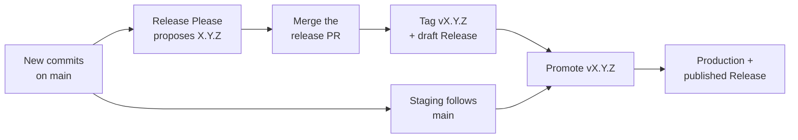

# CI / CD

This repository keeps four decisions separate: whether code is correct, which
version is prepared, which exact commit was accepted in staging, and which
version is formally offered to users.

| Gate | Trigger | Outcome |
| --- | --- | --- |
| CI (`.github/workflows/ci.yml`) | Pull request push, and push to `main` | One run per change with seven named gates, then on `main` Release Please, which opens a Release PR with a SemVer version and changelog. Merging that PR tags the merge commit `vX.Y.Z` and leaves a draft GitHub Release, which is not published. |
| Deploy staging (job in `ci.yml`) | Push to `main`, after every gate | Deploys that exact commit to staging and records a GitHub deployment. Skipped for documentation-only pushes and while paused. |
| Promote (`.github/workflows/promote.yml`) | Manual dispatch from `main`, with a version number | The promote guard accepts or refuses. On accept, that version's exact commit deploys to production and its GitHub Release is published. |

The GitHub Release page is therefore a public statement of the version that is
actually in production. A tagged version with no published Release was never
promoted.

## At a glance



The tag appears when the release PR is merged, so Release Please always has a
changelog boundary. Promote is the only step that puts a version in production
and the only step that publishes its Release. `npm run status` shows where each
of these stands.

## One change, one run

`.github/workflows/ci.yml` is the only automatic workflow. A push to a pull
request branch starts exactly one run, a push to `main` starts exactly one run,
and a tag push starts none. A branch without a pull request has no run until one
is opened, because running on both branch pushes and pull requests is what made
every pull request push appear twice.

Each check is its own job, so a red run names the gate that failed and the other
gates still report their own result:

| Gate | What it runs |
| --- | --- |
| Formatting and lint | `ruff format --check` and `ruff check` |
| Type check | `npm run typecheck` |
| Frontend tests | `npm run test:ui` |
| Build | `npm run build` |
| Migration check | `scripts/check_migrations.py` |
| Backend and browser tests | `npm run build`, Playwright Chromium, then `pytest -q` |
| Diff hygiene | `scripts/check_ci_diff.sh` |

After the gates, a Summary job lists each gate and its outcome on the run page,
and fails the run if any gate did not succeed. On `main` only, the Release
Please job runs after every gate has passed, so a red gate also holds back the
release proposal. Release behavior itself is unchanged.

## Staging follows main

On a push to `main`, the same run deploys that commit to staging once every gate
has passed. The `Deploy staging` job needs all seven gates and the `Staging
scope` job, and it deploys `github.sha`, the pushed commit, never the branch
head. Re-running an earlier run therefore returns staging to that earlier
commit. The job builds, applies the staging D1 migrations, then runs `pywrangler deploy --config wrangler.staging.jsonc
--keep-vars`. It uses the `staging` environment, so GitHub records a deployment
for that commit; that record, not any tag, is the source of truth for what
staging is showing. The job summary also names the commit.

Staging is unchanged in what it may do: its configuration still holds sends, has
no LINE access token, and reads no hospital data (see
[Evidence boundaries](#evidence-boundaries)).

Skips are decided on the `Deploy staging` job, not by path filters, so a skipped
deployment still leaves a successful run:

| Situation | Staging job | Run | What to do |
| --- | --- | --- | --- |
| Product-changing push, gates green | Runs and succeeds | Success | Nothing. The staging deployment names the commit. |
| Waiting behind another staging deployment | Pending | In progress | Nothing. Deployments run one at a time in the `staging-deploy` group. GitHub keeps only the newest waiting run, so an older waiting one is cancelled and staging ends on the latest commit. |
| A gate fails | Skipped | Failed, naming the gate | Fix the gate. Staging keeps its previous commit. |
| Documentation-only push (every changed file is `*.md`) | Skipped | Success | Nothing. Staging keeps its commit. An unknown range, such as a forced push, counts as not documentation-only. |
| Repository variable `STAGING_DEPLOY_PAUSED` is `true` | Skipped | Success | Gates still run. Clear the variable, then push or re-run the run of the commit you want. |
| Staging migration or deploy step fails | Failed | Failed | See below. |

Pausing and resuming: set `STAGING_DEPLOY_PAUSED` to `true` in **Settings ->
Secrets and variables -> Actions -> Variables** to pause, and delete it or set
anything else to resume. The variable is read when the job is evaluated, so
resume takes effect on the next push or re-run, not retroactively.

Recovery from a failed staging migration: migrations are forward-only and D1
applies each migration file atomically, so a failure leaves the database at the
last migration that fully applied and the Worker still on its previous code. Read
the failing step in the run, then either fix forward with a new commit, which
deploys automatically once its gates pass, or correct the cause outside the
repository (for example the Cloudflare token) and re-run only the failed job.
Do not edit an applied migration. If staging has to be held while you
investigate, pause it first. Staging holds no real data, so a database that
cannot be repaired can be recreated and the migrations re-applied.

## Everyday flow

1. Work on a short-lived branch and merge a reviewed, green PR to `main`.
   Staging then updates by itself (see [Staging follows main](#staging-follows-main)).
2. Release Please, the last job of the run on `main`, opens or updates `chore(main): release X.Y.Z`. It updates
   `package.json`, `CHANGELOG.md`, and the release manifest. Opening the PR
   creates no tag and no Release.
3. Review and merge that Release PR. Its merge commit is the version, and the
   next Release Please run tags it `vX.Y.Z`, creates a draft GitHub Release (not
   published), and relabels the merged PR `autorelease: tagged`
   (see [Release PR merge](#release-pr-merge-creates-the-tag)).
   Its CI needs deliberate attention: the PR is pushed by `github-actions[bot]`,
   so CI runs are created but held for manual approval, and an unapproved run
   finishes with no jobs and leaves no failing check on the PR to warn you.
   Approve the run, or verify the branch locally with the README's
   CI-equivalent commands, before merging.
4. Check the version on staging. If staging is not showing it, re-run the run
   of that version's commit in **Actions -> CI**.
5. Run **Promote** with the version number (see [Promote](#promote)).

Do not use a production deployment as a staging test. `workers.dev` URLs are
publicly reachable, so staging protects production users and data through a
separate Worker, D1 database, and Durable Object namespace. It does not make
the URL network-private. Use a separately approved custom domain and Cloudflare
Access policy if network-level access control is required.

## Required setup

### Cloudflare staging resources

The staging D1 database is `next-is-you-staging` in APAC. Its stable binding is
recorded in `wrangler.staging.jsonc`; it is distinct from production. The first
first successful staging deployment creates the `next-is-you-staging` Worker and its
separate `SystemSendGate` Durable Object namespace.

Before the first staging deployment, configure the staging Worker and GitHub
environment without copying production data:

1. In GitHub **Settings -> Environments**, create `staging`. Add
   `CLOUDFLARE_API_TOKEN` and `CLOUDFLARE_ACCOUNT_ID` as its environment
   secrets. The token needs `Account - Workers Scripts - Edit`, `Account - D1 -
   Edit`, and `Account - Account Settings - Read` for this account. Restrict the
   environment to the `main` branch.
2. In LINE Developers Console, add this additional callback URL to the existing
   LINE Login channel:

   ```text
   https://next-is-you-staging.<owner-subdomain>.workers.dev/auth/line/callback
   ```

   LINE supports more than one callback URL per channel. Do not replace the
   production callback.
3. After the first Worker deployment, set the staging Worker's
   `LINE_LOGIN_REDIRECT_URI`. It is absent from the committed config on purpose,
   so it has to be supplied once per Worker and is then preserved by the
   `--keep-vars` that every later deploy already uses:

   ```sh
   uv run python -m pywrangler deploy --config wrangler.staging.jsonc --keep-vars \
     --var "LINE_LOGIN_REDIRECT_URI:https://next-is-you-staging.<owner-subdomain>.workers.dev/auth/line/callback"
   ```

   Organizer login returns `503 Organizer LINE Login is not configured` until
   this var and the three secrets below are all in place, because
   `organizer_login_ready` in `src/worker.py` requires every one of them.

4. Using masked local prompts, set the three Worker secrets on staging. Never
   place their values in GitHub Actions, repository files, logs, or issue
   comments.

   ```sh
   uv run python -m pywrangler secret put LINE_LOGIN_CHANNEL_SECRET --config wrangler.staging.jsonc
   uv run python -m pywrangler secret put SESSION_SIGNING_SECRET --config wrangler.staging.jsonc
   uv run python -m pywrangler secret put ORGANIZER_LINE_SUBJECTS --config wrangler.staging.jsonc
   ```

   `LINE_LOGIN_CHANNEL_SECRET` is the production value, because both
   environments use the shared Login channel. `SESSION_SIGNING_SECRET` must be a
   new value that production does not use; it is what stops a staging session
   from authenticating against production. `ORGANIZER_LINE_SUBJECTS` is normally
   the same subject as production, since a LINE subject is stable per provider,
   and may be narrowed to a staging-only organizer instead.
   [docs/SECRETS.md](SECRETS.md) is the inventory for both environments.

   `LINE_CHANNEL_ACCESS_TOKEN` remains absent. The application keeps sending
   held in staging and production until Issue #22 authorizes a live pilot.

### GitHub environments

`staging` runs deployments from `main`. `prod` runs Promote, which is
dispatched from `main`. Keep the production environment's existing Cloudflare
secrets and its protection settings. Replace its old candidate-tag deployment
policy (`candidate-v*`) with the branch `main`, because candidate tags no longer
exist as a deployment path and formal release tags never deployed anything.

The deployment branch policies must therefore be:

| Environment | Allowed ref | Purpose |
| --- | --- | --- |
| `staging` | branch `main` | Automatic staging deployment after a green push to `main`. |
| `prod` | branch `main` | Promote, dispatched from `main`; the guard then checks the version's commit. |

## Release PR merge creates the tag

`.github/release-please-config.json` sets `"draft": true` and
`"force-tag-creation": true`, and the action is not given `skip-github-release`.
The Release Please run triggered by the merge of a release PR then, per the
library source (`release-please` 17.6.0, bundled by the pinned action v5.0.0):

1. creates the `refs/tags/vX.Y.Z` reference on the merge commit (a 422 because
   the tag already exists is ignored, so a re-run is harmless);
2. creates a draft GitHub Release for that tag, which GitHub does not show
   publicly and which is not a published Release;
3. comments on the merged PR and swaps its label from `autorelease: pending`
   to `autorelease: tagged`.

`force-tag-creation` is a Release Please config option, not an action input:
GitHub does not create the Git tag for a draft release until it is published,
so without it the draft would leave Release Please without a boundary. With the
tag in place the next changelog starts after the version, whether or not the
draft is ever published.

Publishing the draft is the Promote step's job and is not done by CI. Until
then the version is tagged and is not a Release. The tag appears on the next run
of CI on `main` after the merge, not inside the merge itself.

The four existing `candidate-v*` tags stay as history. Nothing creates or
reads them any more.

## Why the tag is created at merge

Release Please finds the boundary for the next changelog by deriving a tag name
from the version in `.github/.release-please-manifest.json` and looking for that
tag. When the tag only appeared after production promotion, a merged release PR
that was not promoted left the manifest ahead of every tag: Release Please fell
back to scanning the whole history, every proposal carried a changelog covering
every commit, and earlier runs aborted with `There are untagged, merged release
PRs outstanding`. That stalled versioning between 2026-11-01 and 2026-11-14.
Neither `last-release-sha` nor the `autorelease` labels restored the boundary.

Creating the tag at release PR merge removes the dependency on promotion, so a
delayed or rejected Promote can no longer stall versioning. The
`check:release` script that guarded the old gap is gone.

## Release and rollback rules

Release Please reads Conventional Commit messages:

- `feat:` creates a minor version proposal.
- `fix:` and `perf:` create a patch proposal.
- `feat!:` or `BREAKING CHANGE:` creates a major version proposal.
- `docs:`, `chore:`, `refactor:`, `test:`, `build:`, `ci:`, and `style:` do not
  bump a version. Reserve `feat:`, `fix:`, and `perf:` for changes a user of the
  product can notice.
- `docs:` is a hidden changelog type: a documentation-only push opens no release
  PR and does not change an open one. Before 2026-11-15 it had a visible
  section, and commit `1a7e76e` alone proposed 0.2.1.
- A breaking-change marker or a `Release-As` footer can still release on a
  hidden type, so avoid them on non-user-facing commits.

Production migrations are forward-only. See [Rollback](#rollback).

## Promote

Promote is **Actions -> Promote -> Run workflow**, from `main`, with one input:
the version, for example `v0.3.0`. Only the captain runs it. Its `Promote guard`
job runs `python3 scripts/delivery_state.py guard <version>`, the same command
the captain can run locally, and writes the verdict to the run summary. The
rules are not repeated in the workflow. The guard refuses, with one reason and
the action that clears it, when:

| Reason | Clearing action |
| --- | --- |
| The version is unknown | Enter an existing version. |
| Its commit is not on `main` | Do not promote it; merge the release PR to cut a new version. |
| Its checks failed | Re-run that commit's pipeline run if the failure is not real, otherwise fix `main` and release a new version. |
| Its checks are still running | Wait, then run Promote again. |
| Staging is showing a different commit, earlier or later | Re-run that commit's pipeline run so staging shows it, check it, then run Promote again. If staging deployment is paused, resume it first. |

On accept, the `Deploy` job checks out the exact commit the guard resolved,
applies production migrations, deploys production, and then publishes the
GitHub Release. The Release step runs only after a successful deployment and is
keyed on the Release being absent or a draft: a draft made by Release Please is
published with its changelog notes; a Release that is already published (for
example `v0.2.0` and `v0.2.1`, made before this design) is left alone.

| Outcome | What the captain sees | What to do |
| --- | --- | --- |
| Success | Both jobs green. The `Deploy` summary names the commit, the status and the Release state. The Release is published. | Nothing. `npm run status` shows the version as production. |
| Pending | `Deploy` waits in the `production-deploy` group behind another Promote. | Nothing. Runs go one at a time. |
| Refusal | `Promote guard` fails. The run summary shows `Refused:` and `To clear it:`. Nothing deployed. | Do the clearing action, then run Promote again. |
| Failure | `Deploy` fails at a migration or deploy step. No Release is published. | Read the failing step, fix forward or correct the cause, then run Promote again. If production is wrong in the meantime, use the native rollback below. |
| Recovery | A failed run, or a retry after a network failure. | Run Promote again with the same version. Applied migrations are skipped, the Worker redeploys the same commit, and a published Release is left unchanged. |

## Rollback

Rollback is Promote with an earlier version, including `v0.2.0` and `v0.2.1`,
which predate this design. It restores code only. Production migrations are
forward-only, so it does not reverse D1 schema or Durable Object state; write a
forward migration if the data model needs repair. The same guard applies, so
staging must show the earlier version first: re-run that version's pipeline run
in **Actions -> CI**, then run Promote. If that run cannot be re-run, for
example because it predates the current workflow, the guard cannot be
satisfied; use the native emergency procedure:

```sh
uv run python -m pywrangler rollback --config wrangler.production.jsonc
```

| Outcome | What the captain sees | What to do |
| --- | --- | --- |
| Success | Promote succeeds for the earlier version. Its Release was already published, so none is created. | Nothing. Production runs the earlier code. |
| Pending | As for Promote. | Nothing. |
| Refusal | As for Promote, usually staging showing another commit. | Re-run the earlier version's pipeline run, then run Promote again. |
| Failure | As for Promote. | As for Promote; the native rollback is the emergency path. |
| Recovery (roll forward) | Production runs the earlier version and `main` is ahead. | Re-run the pipeline run of the version you want back, check staging, run Promote for it. |

## Captain steps

1. Once, before the first Promote: **Settings -> Environments -> prod ->
   Deployment branches and tags**. Change the selected-branches-and-tags rule
   from the tag pattern `candidate-v*` to **branch `main`**. Leave **staging**
   restricted to branch `main`.
2. Release: merge the release PR, check the version on staging, then **Actions ->
   Promote -> Run workflow**, **Use workflow from: Branch: main**, enter the
   version, and run.
3. One rollback rehearsal: run **Promote** with an earlier version (after
   re-running its pipeline run in **Actions -> CI** if staging does not show
   it), confirm production runs it, then re-run the pipeline run of the newer
   version and run **Promote** with that version to restore it.

## Evidence boundaries

CI is fixture/mock and local automated evidence. Automatic staging deployment proves
only the staging platform path. A production promotion proves the deployment
path for the selected immutable commit. Neither proves current hospital data,
LINE provider acceptance, or handset delivery. Follow
`docs/PRE-LIVE-CHECKLIST.md` and Issue #22 for those gates.
