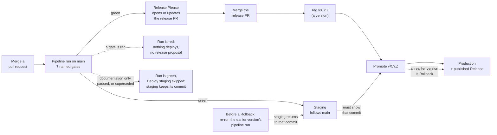

# CI / CD

Three captain actions move a change forward, and one command reports on it.
Merge a pull request, and staging follows by itself. Merge the release PR, and
that commit becomes a version. Run Promote with the version number, and it
becomes the Release in production. `npm run status` prints where everything
stands and the next step. Two more actions hold or undo: Pause staging and
Rollback. All five are in [The captain's actions](#the-captains-actions).

Terms follow [GLOSSARY.md](../GLOSSARY.md); the reasons for the design are in
[ADR 0001](adr/0001-version-at-release-commit-staging-follows-main.md). Three
of them carry this guide:

- The **captain** is the one person who decides what is accepted into the
  product and what reaches production. Agents and automation do the rest of the
  work.
- A **pipeline run** is the one run of the **CI** workflow that a change
  starts: one per push to a pull request branch, one per push to `main`. On
  GitHub it is a row under **Actions -> CI**, titled with the first line of the
  commit message. This guide also calls it "the run". A run of the Promote
  workflow is a Promote run, not a pipeline run.
- A **gate** is one of the seven named checks in a pipeline run (see
  [One change, one run](#one-change-one-run)).

## At a glance



Solid arrows are the path a change takes. Dotted arrows are the skips and the
way back: a skipped `Deploy staging` leaves staging on the commit it had, and a
Rollback needs staging to show the earlier version first, which re-running that
version's pipeline run does.

A version is born when the release PR merges, so Release Please always has a
changelog boundary. Promote is the only step that puts a version in production
and the only step that publishes its Release. A tagged version with no
published Release is pending or was rejected; it never reached users.

## The captain's actions

Each action lists what the captain sees. "Page" is where to look; "Control" is
what to press. Run `npm run status` at any point for the same facts in one
place.

| Action | Page and control | Success | Pending | Failure | Stop | Recovery |
| --- | --- | --- | --- | --- | --- | --- |
| **Merge a pull request** | Pull request page, **Squash and merge** (the only method the repository allows). Result on **Actions -> CI** and the repository **Deployments** list (environment `staging`). | The run on `main` is green. `Deploy staging` is green and the new deployment names the commit. | The run is in progress, or `Deploy staging` shows pending behind an earlier staging deployment. Nothing to do. | A gate is red and named on the run page; `Deploy staging` is skipped and staging keeps its previous commit. Or `Deploy staging` is red: a migration or deploy step failed. | Pause staging before merging (last row). Or cancel the run in **Actions -> CI -> Cancel workflow**, which does not undo a step already finished. | Fix forward with a new pull request. A flaky gate: **Re-run failed jobs**. A failed staging step: see [Recovery from a failed staging migration](#staging-follows-main). |
| **Merge the release PR** | Pull request `chore(main): release X.Y.Z`, **Squash and merge**. Result on **Actions -> CI** (Release Please job), the **Tags** list, and the **Releases** page. | The squash commit is tagged `vX.Y.Z`, the PR is labelled `autorelease: tagged`, and a draft Release exists, visible to the captain only. No Release is published. | Its own checks are held for approval (the PR is pushed by `github-actions[bot]`); approve them as in step 3 of [Everyday flow](#everyday-flow). After the merge, the run on `main` is in progress. The tag appears when that run's Release Please job finishes. | A gate on the merge commit is red, so Release Please does not run and no tag exists. | Do not merge. Leaving the PR open collects more changes into the same version; closing it makes Release Please open a fresh one. After merging, rejecting the version needs no action: do not promote it. | Fix forward and re-run the failed jobs; Release Please tags once every gate is green. A rejected version keeps its tag, its changelog section and no Release; its fix ships as the next version. |
| **Promote** | **Actions -> Promote -> Run workflow**, **Use workflow from: Branch: main**, enter the version, **Run workflow**. Result on the run page and the **Releases** page. | Both jobs green. The run summary names the commit; the Release is published and marked **Latest**; `npm run status` shows the version as production. | The run is queued behind another Promote (group `production-deploy`; only the newest waiting run is kept). Nothing to do. | `Promote guard` is red: the summary shows `Refused:` and `To clear it:`, and nothing deployed. Or `Deploy` is red at a migration or deploy step: no Release is published, and a migration that already applied stays applied. | Cancel the run in **Actions -> Promote -> Cancel workflow** before `Deploy` starts. After production migrations have applied, there is no clean stop: roll forward. | Do the clearing action and run Promote again. Running it again for the same version is harmless: applied migrations are skipped and a published Release keeps its notes and state, and only its Latest mark is set again. If production is wrong meanwhile, use the native rollback below. |
| **Rollback** | Same as Promote, with an earlier version number. | Promote succeeds for the earlier version, and production runs its code. Its Release was already published, so none is created; the **Latest** mark moves to it, so the Releases page names what production runs. A failed or refused Promote leaves Latest where it was. If only the Latest step fails, the run stays green and its summary says `Latest Release: NOT moved`; set it by hand with `gh release edit vX.Y.Z --latest`. | As for Promote. | As for Promote. Usually the guard refusing because staging shows another commit. | As for Promote. | Read [Rollback](#rollback) first: it restores code only, so the earlier code runs against today's database. Re-run that version's pipeline run in **Actions -> CI** so staging shows it, then run Promote. To go forward again, repeat for the newer version. The native rollback is the emergency path if Promote is unusable; it skips the guard. |
| **Pause staging** | **Settings -> Secrets and variables -> Actions**, the **Variables** tab, **New repository variable**: name `STAGING_DEPLOY_PAUSED`, value `true`, **Add variable**. If it already exists, edit its value. | The next push to `main` passes its gates, shows `Deploy staging` as skipped, and the run is green. `npm run status` reports that automatic staging deployment is paused. | A staging job already queued or running when you set the variable still deploys: the variable is read when the run starts. Wait for it to finish before relying on the pause. | Any other value (`1`, `yes`, `true` with a stray space) pauses nothing: the next push deploys. `npm run status` then prints a `not paused` line naming the value, and the pipeline run of each push to `main` shows the warning **Staging deployment is not paused** on its run page. A typo in the variable's name also pauses nothing, and nothing warns about it: `npm run status` shows no `paused` line. | Delete the variable, or set it to `false`. | Resume, then push or re-run the pipeline run of the commit you want shown on staging. Promote refuses while staging shows another commit, so a forgotten pause surfaces there and in `npm run status`. |

## One change, one run

`.github/workflows/ci.yml` is the only automatic workflow. A push to a pull
request branch starts exactly one run, a push to `main` starts exactly one run,
and a tag push starts none. A branch without a pull request has no run until one
is opened, because running on both branch pushes and pull requests is what made
every pull request push appear twice.

Each check is its own job, so a red run names the gate that failed and the other
gates still report their own result:

| Gate | What it runs |
| --- | --- |
| Formatting and lint | `ruff format --check` and `ruff check` |
| Type check | `npm run typecheck` |
| Frontend tests | `npm run test:ui` |
| Build | `npm run build` |
| Migration check | `scripts/check_migrations.py` |
| Backend and browser tests | `npm run build`, Playwright Chromium, then `pytest -q` |
| Diff hygiene | `scripts/check_ci_diff.sh` |

After the gates, a Summary job lists each gate and its outcome on the run page,
and fails the run if any gate did not succeed. On `main` only, the Release
Please job runs after every gate has passed, so a red gate also holds back the
release proposal. Release behavior itself is unchanged.

## Staging follows main

On a push to `main`, the same run deploys that commit to staging once every gate
has passed. The `Deploy staging` job needs all seven gates, the `Staging
scope` job and the `Staging order` job, and it deploys `github.sha`, the pushed commit, never the branch
head. Re-running an earlier run therefore returns staging to that earlier
commit. The job builds, applies the staging D1 migrations, then runs
`pywrangler deploy --config wrangler.staging.jsonc --keep-vars`. It uses the `staging` environment, so GitHub records a deployment
for that commit; that record, not any tag, is the source of truth for what
staging is showing. The job summary also names the commit.

Staging is unchanged in what it may do: its configuration still holds sends, has
no LINE access token, and reads no hospital data (see
[Evidence boundaries](#evidence-boundaries)).

Skips are decided on the `Deploy staging` job, not by path filters, so a skipped
deployment still leaves a successful run:

| Situation | Staging job | Run | What to do |
| --- | --- | --- | --- |
| Product-changing push, gates green | Runs and succeeds | Success | Nothing. The staging deployment names the commit. |
| Waiting behind another staging deployment | Pending | In progress | Nothing. Deployments run one at a time in the `staging-deploy` group. GitHub keeps only the newest waiting run, so an older waiting one is cancelled and staging ends on the latest commit. |
| A gate fails | Skipped | Failed, naming the gate | Fix the gate. Staging keeps its previous commit. |
| Documentation-only push (every changed file is `*.md`) | Skipped | Success | Nothing. Staging keeps its commit. An unknown range, such as a forced push, counts as not documentation-only. |
| Main has already moved past this commit (a newer push finished its gates first) | Skipped | Success | Nothing. The `Staging order` summary says `superseded` and names both commits. Staging keeps the newer commit. A re-run of this run deploys it anyway, which is how you return staging to it. |
| Repository variable `STAGING_DEPLOY_PAUSED` is `true` (letter case is ignored) | Skipped | Success | Gates still run. Delete the variable, then push or re-run the run of the commit you want. |
| Staging migration or deploy step fails | Failed | Failed | See below. |

Staging order: two pushes close together finish their gates in either order, and
the queue for `Deploy staging` follows who finishes first, not commit order. So
the `Staging order` job runs after the gates and asks `scripts/delivery_state.py
staging-order` whether the commit is still the head of `main`. A first-attempt
run for an older commit does not deploy, and the run stays green. A re-run
(attempt 2 or later) always deploys the commit it ran for. A small window remains:
if `main` moves between that check and the deployment starting, the older commit
can still deploy; `npm run status` then reports staging differs from `main`, and
re-running the run of the head of `main` fixes it.

Pausing and resuming: open **Settings -> Secrets and variables -> Actions** and
its **Variables** tab. To pause, set the repository variable
`STAGING_DEPLOY_PAUSED` to `true` (**New repository variable** if it does not
exist yet). To resume, delete it or set it to `false`. Hold staging still this way before a long check or a
storage recovery rehearsal. The variable is read when a run starts, so a pause
does not stop a staging job already queued, and a resume takes effect on the
next push or re-run, not retroactively. `npm run status` says while staging is
paused. It and the promote guard apply the workflow's rule: only the value
`true`, in any letter case, pauses.

A value that is neither `true` nor `false` (`yes`, `1`, `true` followed by a
space) does not pause, and was most likely typed to pause. Two places say so.
`npm run status` prints a `not paused` line that shows the value, and its next
step is to set the variable to `true` or `false`. The pipeline run of a push to
`main` shows the warning **Staging deployment is not paused** on its run page,
under **Annotations** and in the run summary; the run's result is unchanged.
Nothing can warn about a misspelt variable name, because a variable under
another name is simply a different variable.

Recovery from a failed staging migration: migrations are forward-only and D1
applies each migration file atomically, so a failure leaves the database at the
last migration that fully applied and the Worker still on its previous code. Read
the failing step in the run, then either fix forward with a new commit, which
deploys automatically once its gates pass, or correct the cause outside the
repository (for example the Cloudflare token) and re-run only the failed job.
Do not edit an applied migration. If staging has to be held while you
investigate, pause it first. Staging holds no real data, but recreating its database changes the
pinned database id in `wrangler.staging.jsonc`, so that needs the owner's decision.

## Everyday flow

1. Land work on `main`. Documentation-only changes may be pushed straight to
   `main`. Changes to code, migrations, workflows, or deployment configuration
   arrive through a pull request the captain merges, because a commit on `main`
   reaches staging and its database within minutes. An agent without the
   captain's direct instruction always opens a pull request. Staging then
   updates by itself (see [Staging follows main](#staging-follows-main)).
2. Release Please, the last job of the run on `main`, opens or updates
   `chore(main): release X.Y.Z`. It updates `package.json`, `CHANGELOG.md`, and
   the release manifest. Opening the PR creates no tag and no Release. A range
   of only `docs`, `chore`, `ci`, `test`, `build`, `refactor`, and `style`
   commits opens none.
3. Review and merge that release PR. Its squash commit is the version, and the
   Release Please run that follows tags it `vX.Y.Z`, creates a draft GitHub
   Release (not published), and relabels the merged PR `autorelease: tagged`
   (see [Release PR merge](#release-pr-merge-creates-the-tag)).
   Its checks need deliberate attention: the PR is pushed by
   `github-actions[bot]`, so its pipeline run is created but held for manual
   approval. A held run finishes with no jobs and leaves no failing check on
   the PR to warn you. Before merging, do one of these:

   - Approve the run. On the release PR's page, the merge box lists the
     workflow as awaiting approval; press **Approve workflows to run** there.
     The held run is also listed under **Actions -> CI**, titled
     `chore(main): release X.Y.Z` and marked as needing action. Wait for the
     seven gates to go green.
   - Or verify the branch locally. Check out the release PR's branch and run
     the commands CI runs:

     ```sh
     npm ci
     uv sync --group dev --locked
     uv run playwright install chromium
     uv run ruff format --check src tests scripts
     uv run ruff check src tests scripts
     npm run typecheck
     npm run test:ui
     npm run build
     uv run python scripts/check_migrations.py
     uv run pytest -q
     git diff --check
     ```

   Either way the squash commit is checked again on `main`, and Promote refuses
   the version until those checks pass.
4. Check the version on staging. Three things, in this order:

   - **Is staging showing the version?** Run `npm run status` from a checkout
     of `main` that is up to date. Once the tag exists it prints a line
     `tagged      vX.Y.Z - tagged, not yet a Release`, and its next step says
     which case you are in. `Check vX.Y.Z on staging, then promote it.` means
     staging shows the version's commit. `Put vX.Y.Z on staging (staging shows
     abc1234), check it, then promote it.` means it shows another commit. What
     is compared is the commit of the latest successful staging deployment
     (the repository's **Deployments** list, environment `staging`) and the
     commit the tag points at (the **Tags** list).
   - **If it is not, put it there.** Open **Actions -> CI** and find the
     version's pipeline run: the run on `main` titled `chore(main): release X.Y.Z (#N)`,
     where `N` is the release PR's number. From a terminal,
     `gh run list --workflow CI --commit <the tag's commit>` lists it. Open it
     and press **Re-run all jobs**. A re-run deploys the commit it ran for,
     unless staging is paused. When `Deploy staging` is green, run `npm run
     status` again.
   - **Look at it.** Open the staging site: its URL is on the `Deploy staging`
     job's summary and behind **View deployment** on the staging deployment.
     Sign in as an organizer and try what the release PR's changelog says
     changed. Staging sends nothing and reads no hospital data, so this checks
     the product's own screens and behavior only (see [Evidence
     boundaries](#evidence-boundaries)).
5. Run **Promote** with the version number (see [Promote](#promote)). Read the
   warning there about migrations before the first Promote of a version that
   adds one.

Only the captain, in person, merges the release PR and runs Promote. Nothing on
the hosting plan enforces this; it is a written rule in `AGENTS.md`.

Do not use a production deployment as a staging test. `workers.dev` URLs are
publicly reachable, so staging protects production users and data through a
separate Worker, D1 database, and Durable Object namespace. It does not make
the URL network-private. Use a separately approved custom domain and Cloudflare
Access policy if network-level access control is required.

## Required setup

### Cloudflare staging resources

The staging D1 database is `next-is-you-staging` in APAC. Its stable binding is
recorded in `wrangler.staging.jsonc`; it is distinct from production. The first
successful staging deployment creates the `next-is-you-staging` Worker and its
separate `SystemSendGate` Durable Object namespace.

Before the first staging deployment, configure the staging Worker and GitHub
environment without copying production data:

1. In GitHub **Settings -> Environments**, create `staging`. Add
   `CLOUDFLARE_API_TOKEN` and `CLOUDFLARE_ACCOUNT_ID` as its environment
   secrets. The token needs `Account - Workers Scripts - Edit`, `Account - D1 -
   Edit`, and `Account - Account Settings - Read` for this account. Restrict the
   environment to the `main` branch.
2. In LINE Developers Console, add this additional callback URL to the existing
   LINE Login channel:

   ```text
   https://next-is-you-staging.<owner-subdomain>.workers.dev/auth/line/callback
   ```

   LINE supports more than one callback URL per channel. Do not replace the
   production callback.
3. After the first Worker deployment, set the staging Worker's
   `LINE_LOGIN_REDIRECT_URI`. It is absent from the committed config on purpose,
   so it has to be supplied once per Worker and is then preserved by the
   `--keep-vars` that every later deploy already uses:

   ```sh
   uv run python -m pywrangler deploy --config wrangler.staging.jsonc --keep-vars \
     --var "LINE_LOGIN_REDIRECT_URI:https://next-is-you-staging.<owner-subdomain>.workers.dev/auth/line/callback"
   ```

   Organizer login returns `503 Organizer LINE Login is not configured` until
   this var and the three secrets below are all in place, because
   `organizer_login_ready` in `src/worker.py` requires every one of them.

4. Using masked local prompts, set the three Worker secrets on staging. Never
   place their values in GitHub Actions, repository files, logs, or issue
   comments.

   ```sh
   uv run python -m pywrangler secret put LINE_LOGIN_CHANNEL_SECRET --config wrangler.staging.jsonc
   uv run python -m pywrangler secret put SESSION_SIGNING_SECRET --config wrangler.staging.jsonc
   uv run python -m pywrangler secret put ORGANIZER_LINE_SUBJECTS --config wrangler.staging.jsonc
   ```

   `LINE_LOGIN_CHANNEL_SECRET` is the production value, because both
   environments use the shared Login channel. `SESSION_SIGNING_SECRET` must be a
   new value that production does not use; it is what stops a staging session
   from authenticating against production. `ORGANIZER_LINE_SUBJECTS` is normally
   the same subject as production, since a LINE subject is stable per provider,
   and may be narrowed to a staging-only organizer instead.
   [docs/SECRETS.md](SECRETS.md) is the inventory for both environments.

   `LINE_CHANNEL_ACCESS_TOKEN` remains absent. The application keeps sending
   held in staging and production until Issue #22 authorizes a live pilot.

### GitHub environments

`staging` runs deployments from `main`. `prod` runs Promote, which is
dispatched from `main`. Keep the production environment's existing Cloudflare
secrets and its protection settings. Its deployment policy must be the branch
`main`. Before this design it was the tag pattern `candidate-v*`, which deploys
nothing now and must be replaced (see [Captain steps](#captain-steps)).

The deployment branch policies must therefore be:

| Environment | Allowed ref | Purpose |
| --- | --- | --- |
| `staging` | branch `main` | Automatic staging deployment after a green push to `main`. |
| `prod` | branch `main` | Promote, dispatched from `main`; the guard then checks the version's commit. |

## Release PR merge creates the tag

`.github/release-please-config.json` sets `"draft": true` and
`"force-tag-creation": true`, and the action is not given `skip-github-release`.
The Release Please run triggered by the merge of a release PR then, per the
library source (`release-please` 17.6.0, bundled by the pinned action v5.0.0):

1. creates the `refs/tags/vX.Y.Z` reference on the squash commit (a 422 because
   the tag already exists is ignored, so a re-run is harmless);
2. creates a draft GitHub Release for that tag, which GitHub does not show
   publicly and which is not a published Release;
3. comments on the merged PR and swaps its label from `autorelease: pending`
   to `autorelease: tagged`.

`force-tag-creation` is a Release Please config option, not an action input:
GitHub does not create the Git tag for a draft release until it is published,
so without it the draft would leave Release Please without a boundary. With the
tag in place the next changelog starts after the version, whether or not the
draft is ever published.

Publishing the draft is the Promote step's job and is not done by CI. Until
then the version is tagged and is not a Release. The tag appears on the next run
of CI on `main` after the merge, not inside the merge itself.

The four existing `candidate-v*` tags stay as history. Nothing creates or
reads them any more.

## Why the tag is created at merge

Release Please finds the boundary for the next changelog by deriving a tag name
from the version in `.github/.release-please-manifest.json` and looking for that
tag. When the tag only appeared after production promotion, a merged release PR
that was not promoted left the manifest ahead of every tag: Release Please fell
back to scanning the whole history, every proposal carried a changelog covering
every commit, and earlier runs aborted with `There are untagged, merged release
PRs outstanding`. That stalled versioning between 2026-11-01 and 2026-11-14.
Neither `last-release-sha` nor the `autorelease` labels restored the boundary.

Creating the tag at release PR merge removes the dependency on promotion, so a
delayed or rejected Promote can no longer stall versioning. The
`check:release` script that guarded the old gap is gone.

## Release and rollback rules

Pull requests are squash-merged only (`allow_merge_commit` and
`allow_rebase_merge` are off, the squash commit title is the PR title and its
message is blank). So the PR title is the one Conventional Commit that lands on
`main`, and Release Please counts each PR once. With merge commits the body of
`Merge pull request #N` repeated the PR title, so every PR was listed twice in
release PR #114 (#126). A PR title that is not a Conventional Commit is skipped
by Release Please without any warning, so write it as one.

Release Please reads Conventional Commit messages:

- `feat:` creates a minor version proposal.
- `fix:` and `perf:` create a patch proposal.
- `feat!:` or `BREAKING CHANGE:` creates a major version proposal.
- `docs:`, `chore:`, `refactor:`, `test:`, `build:`, `ci:`, and `style:` do not
  bump a version. Reserve `feat:`, `fix:`, and `perf:` for changes a user of the
  product can notice.
- `docs:` is a hidden changelog type: a documentation-only push opens no release
  PR and does not change an open one. Before 2026-11-15 it had a visible
  section, and commit `1a7e76e` alone proposed 0.2.1.
- A breaking-change marker or a `Release-As` footer can still release on a
  hidden type, so avoid them on non-user-facing commits.

Production migrations are forward-only. See [Rollback](#rollback).

## Promote

Promote is **Actions -> Promote -> Run workflow**, from `main`, with one input:
the version, for example `v0.3.0`. Only the captain runs it. Its `Promote guard`
job runs `python3 scripts/delivery_state.py guard <version>`, the same command
the captain can run locally, and writes the verdict to the run summary. The
rules are not repeated in the workflow. A dispatch from any other ref fails the
`Require main` job. "Checks" means the seven CI gate jobs only: the Promote
run itself, a staging deployment (including a cancelled, superseded one) and
Release Please never count. A commit's checks are green only when every gate
concluded `success`; a gate that ended any other way is named with how it
ended, for example `Migration check: skipped`. `npm run status` reports
production as the version named by the Promote run whose `Deploy Worker` step
finished last. A run counts
once that step succeeded, even if a later step (publishing the Release) failed,
and runs are ordered by when that step finished, so re-running an older run is
judged by when it deployed. It does not read the `prod` deployment record: GitHub
files that under the commit Promote was dispatched from (the head of `main`), not
the commit that was deployed. The record is used only when no Promote has
deployed. If a deployment's version cannot be read, for example because the
`Deploy <version> to production` job was renamed, status names `production
version` and exits non-zero instead of guessing; a test fails if `promote.yml`
and the status script stop agreeing on that name.
The guard refuses, with one reason and the action that clears it, when:

| Reason | Clearing action |
| --- | --- |
| The version is unknown | Enter an existing version. |
| Its commit is not on `main` | Do not promote it; merge the release PR to cut a new version. |
| Its checks failed | Re-run that commit's pipeline run if the failure is not real, otherwise fix `main` and release a new version. |
| Its checks are still running | Wait, then run Promote again. |
| Staging is showing a different commit, earlier or later | Re-run that commit's pipeline run so staging shows it, check it, then run Promote again. If staging deployment is paused, resume it first. |

On accept, the `Deploy` job checks out the exact commit the guard resolved,
applies production migrations, deploys production, and then publishes the
GitHub Release. The Release step runs only after a successful deployment and is
keyed on the Release being absent or a draft: a draft made by Release Please is
published with its changelog notes; a Release that is already published (a
version promoted before, as in a Rollback) is left alone. What the captain
sees, and what to do, is in [The captain's actions](#the-captains-actions).

Before running Promote, know what it cannot take back. It applies the version's
production migrations first, and migrations are forward-only: once one has
applied it stays applied, whether the deploy step after it fails or a later
Rollback returns the code to an earlier version. So for a version that adds a
migration, the check on staging is the last point where stopping costs nothing.
`git diff --name-only <version in production> <version to promote> --
migrations/` lists the migrations a Promote will apply.

## Rollback

Rollback is Promote with an earlier version. The same guard applies, so staging
must show the earlier version first: re-run that version's pipeline run in
**Actions -> CI** (step 4 of [Everyday flow](#everyday-flow) says how to find
it), then run Promote with that version.

Rollback restores code only. Production migrations are forward-only, so it
does not reverse the D1 schema or Durable Object state, and the earlier code
then runs against today's database. Before rolling back, list the migrations
added since the version you are returning to:

```sh
git diff --name-only <earlier version> <version in production> -- migrations/
```

No output means the schema is the one that version was built for. If files are
listed, read them, and roll back only if the earlier code works with those
changes in place. If it does not, leave production where it is and fix
forward: write a forward migration or a code fix and release it as a new
version.

Promote can return production to a version only while that version's pipeline
run can still be re-run, because that is the only way staging comes to show it.
Two things put a version out of reach:

- `v0.2.0` and `v0.2.1` predate this design. Their pipeline runs have no
  `Deploy staging` job, so staging can never show them and the guard always
  refuses them. `v0.2.2` is the earliest version Promote can return to.
- GitHub lets a run be re-run for 30 days after it first ran. A version older
  than that can no longer be put on staging.

For those versions, and whenever Promote itself is unusable, the native
procedure is the only path:

```sh
uv run python -m pywrangler deployments list --config wrangler.production.jsonc
uv run python -m pywrangler rollback <version-id> --config wrangler.production.jsonc
```

The native rollback is an emergency tool, not a second way to release. It does
not go through Promote, so:

- Nothing checks what it deploys. The guard's questions (is the commit on
  `main`, are its checks green, is it what staging shows) are not asked.
- The schema warning above applies in full, and nothing prompts you to look.
  [The HTTPS service guide](HTTPS-SERVICE.md#stop-failure-recovery-and-rollback)
  lists what else to verify afterwards, such as routes and Cron triggers.
- Nothing on GitHub learns of it. The **Latest** mark on the Releases page does
  not move, and `npm run status` keeps naming the last version Promote
  deployed, because that is where it reads production from. Until the next
  successful Promote, only Cloudflare says what production runs: the
  `deployments list` command above, or the Worker's **Deployments** page in the
  Cloudflare dashboard.

If Promote moved production but could not move the **Latest** mark (the run
summary says `Latest Release: NOT moved`), set it by hand:

```sh
gh release edit vX.Y.Z --latest
```

## Captain steps

1. Once, before the first Promote: **Settings -> Environments -> prod ->
   Deployment branches and tags**. If the rule is still the tag pattern
   `candidate-v*`, change it to **branch `main`**. Leave **staging** restricted
   to branch `main`.
2. Release: merge the release PR, check the version on staging, then **Actions ->
   Promote -> Run workflow**, **Use workflow from: Branch: main**, enter the
   version, and run.
3. One rollback rehearsal: run **Promote** with an earlier version (after
   re-running its pipeline run in **Actions -> CI** if staging does not show
   it), confirm production runs it, then re-run the pipeline run of the newer
   version and run **Promote** with that version to restore it.

## Evidence boundaries

CI is fixture/mock and local automated evidence. Automatic staging deployment proves
only the staging platform path. A production promotion proves the deployment
path for the selected immutable commit. Neither proves current hospital data,
LINE provider acceptance, or handset delivery. Follow
`docs/PRE-LIVE-CHECKLIST.md` and Issue #22 for those gates.
