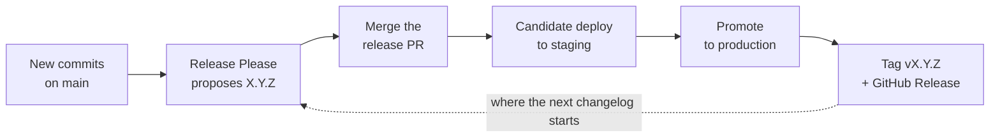

# CI / CD

This repository keeps four decisions separate: whether code is correct, which
version is prepared, which exact commit was accepted in staging, and which
version is formally offered to users.

| Gate | Trigger | Outcome |
| --- | --- | --- |
| CI (`.github/workflows/ci.yml`) | Pull request push, and push to `main` | One run per change with seven named gates, then on `main` Release Please, which opens a Release PR with a SemVer version and changelog. Merging that PR tags the merge commit `vX.Y.Z` and leaves a draft GitHub Release, which is not published. |
| Deploy staging (job in `ci.yml`) | Push to `main`, after every gate | Deploys that exact commit to staging and records a GitHub deployment. Skipped for documentation-only pushes and while paused. |
| Candidate deploy (`.github/workflows/candidate-deploy.yml`) | Manual dispatch | An immutable `candidate-vX.Y.Z-<commit>` tag after that commit deploys to staging. |
| Promote candidate (`.github/workflows/production-deploy.yml`) | Manual dispatch from a candidate tag | The same commit deploys to production, then receives `vX.Y.Z` and a GitHub Release. |

The GitHub Release page is therefore a public statement of the version that is
actually accepted for production use. Candidate tags are engineering deployment
records, not releases.

## At a glance



Two things move through that loop and must end up in step. Merging the release
PR writes the version into `package.json` and the release manifest. Only
promotion creates the matching `vX.Y.Z` tag, and Release Please reads that tag
to know where the next changelog begins.

Between those two steps the version exists and its tag does not, so Release
Please has no boundary and stops proposing versions. That gap is expected while
a candidate is being checked on staging, and it is a stall once it outlives
that check. `npm run check:release` answers which one the repository is in, and
[A merged release PR must be promoted](#a-merged-release-pr-must-be-promoted)
covers what a stall looks like and how to clear it.

## One change, one run

`.github/workflows/ci.yml` is the only automatic workflow. A push to a pull
request branch starts exactly one run, a push to `main` starts exactly one run,
and a tag push starts none. A branch without a pull request has no run until one
is opened, because running on both branch pushes and pull requests is what made
every pull request push appear twice.

Each check is its own job, so a red run names the gate that failed and the other
gates still report their own result:

| Gate | What it runs |
| --- | --- |
| Formatting and lint | `ruff format --check` and `ruff check` |
| Type check | `npm run typecheck` |
| Frontend tests | `npm run test:ui` |
| Build | `npm run build` |
| Migration check | `scripts/check_migrations.py` |
| Backend and browser tests | `npm run build`, Playwright Chromium, then `pytest -q` |
| Diff hygiene | `scripts/check_ci_diff.sh` |

After the gates, a Summary job lists each gate and its outcome on the run page,
and fails the run if any gate did not succeed. On `main` only, the Release
Please job runs after every gate has passed, so a red gate also holds back the
release proposal. Release behavior itself is unchanged.

## Staging follows main

On a push to `main`, the same run deploys that commit to staging once every gate
has passed. The `Deploy staging` job needs all seven gates and the `Staging
scope` job, and it deploys `github.sha`, the pushed commit, never the branch
head. Re-running an earlier run therefore returns staging to that earlier
commit. The job reuses the candidate deployment's steps: build, apply the
staging D1 migrations, then `pywrangler deploy --config wrangler.staging.jsonc
--keep-vars`. It uses the `staging` environment, so GitHub records a deployment
for that commit; that record, not any tag, is the source of truth for what
staging is showing. The job summary also names the commit.

Staging is unchanged in what it may do: its configuration still holds sends, has
no LINE access token, and reads no hospital data (see
[Evidence boundaries](#evidence-boundaries)).

Skips are decided on the `Deploy staging` job, not by path filters, so a skipped
deployment still leaves a successful run:

| Situation | Staging job | Run | What to do |
| --- | --- | --- | --- |
| Product-changing push, gates green | Runs and succeeds | Success | Nothing. The staging deployment names the commit. |
| Waiting behind another staging deployment | Pending | In progress | Nothing. Deployments run one at a time and share the `staging-deploy` group with the manual candidate deploy. GitHub keeps only the newest waiting run, so an older waiting one is cancelled and staging ends on the latest commit. |
| A gate fails | Skipped | Failed, naming the gate | Fix the gate. Staging keeps its previous commit. |
| Documentation-only push (every changed file is `*.md`) | Skipped | Success | Nothing. Staging keeps its commit. An unknown range, such as a forced push, counts as not documentation-only. |
| Repository variable `STAGING_DEPLOY_PAUSED` is `true` | Skipped | Success | Gates still run. Clear the variable, then push or re-run the run of the commit you want. |
| Staging migration or deploy step fails | Failed | Failed | See below. |

Pausing and resuming: set `STAGING_DEPLOY_PAUSED` to `true` in **Settings ->
Secrets and variables -> Actions -> Variables** to pause, and delete it or set
anything else to resume. The variable is read when the job is evaluated, so
resume takes effect on the next push or re-run, not retroactively.

Recovery from a failed staging migration: migrations are forward-only and D1
applies each migration file atomically, so a failure leaves the database at the
last migration that fully applied and the Worker still on its previous code. Read
the failing step in the run, then either fix forward with a new commit, which
deploys automatically once its gates pass, or correct the cause outside the
repository (for example the Cloudflare token) and re-run only the failed job.
Do not edit an applied migration. If staging has to be held while you
investigate, pause it first. Staging holds no real data, so a database that
cannot be repaired can be recreated and the migrations re-applied.

## Everyday flow

1. Work on a short-lived branch and merge a reviewed, green PR to `main`.
2. Release Please, the last job of the run on `main`, opens or updates `chore(main): release X.Y.Z`. It updates
   `package.json`, `CHANGELOG.md`, and the release manifest. Opening the PR
   creates no tag and no Release.
3. Review and merge that Release PR. Its merge commit is the version, and the
   next Release Please run tags it `vX.Y.Z`, creates a draft GitHub Release (not
   published), and relabels the merged PR `autorelease: tagged`
   (see [Release PR merge](#release-pr-merge-creates-the-tag)).
   Its CI needs deliberate attention: the PR is pushed by `github-actions[bot]`,
   so CI runs are created but held for manual approval, and an unapproved run
   finishes with no jobs and leaves no failing check on the PR to warn you.
   Approve the run, or verify the branch locally with the README's
   CI-equivalent commands, before merging.
4. In **Actions -> Candidate deploy**, run the workflow from `main` and enter
   the full 40-character SHA of that merge commit. The workflow verifies the
   commit is already on `main`, applies migrations to the staging D1 database,
   and deploys the staging Worker.
5. If staging succeeds, the workflow creates an immutable tag such as
   `candidate-v0.2.0-73260e2f1a4b`. Test the staging URL and retain the tag from
   the job summary. A failed deployment creates no candidate tag.
6. When the candidate is accepted, open **Actions -> Promote candidate to
   production**, choose that candidate tag in **Use workflow from**, and run it.
   The workflow verifies that the tag agrees with the commit and `package.json`,
   applies production migrations, and deploys production.
7. Only after that deployment succeeds does the workflow create `v0.2.0` and
   its GitHub Release. If the same candidate is run again, it redeploys that
   exact commit and leaves the existing release unchanged.

Do not use a production deployment as a staging test. `workers.dev` URLs are
publicly reachable, so staging protects production users and data through a
separate Worker, D1 database, and Durable Object namespace. It does not make
the URL network-private. Use a separately approved custom domain and Cloudflare
Access policy if network-level access control is required.

## Required setup

### Cloudflare staging resources

The staging D1 database is `next-is-you-staging` in APAC. Its stable binding is
recorded in `wrangler.staging.jsonc`; it is distinct from production. The first
successful candidate workflow creates the `next-is-you-staging` Worker and its
separate `SystemSendGate` Durable Object namespace.

Before running a candidate deployment, configure the staging Worker and GitHub
environment without copying production data:

1. In GitHub **Settings -> Environments**, create `staging`. Add
   `CLOUDFLARE_API_TOKEN` and `CLOUDFLARE_ACCOUNT_ID` as its environment
   secrets. The token needs `Account - Workers Scripts - Edit`, `Account - D1 -
   Edit`, and `Account - Account Settings - Read` for this account. Restrict the
   environment to the `main` branch.
2. In LINE Developers Console, add this additional callback URL to the existing
   LINE Login channel:

   ```text
   https://next-is-you-staging.<owner-subdomain>.workers.dev/auth/line/callback
   ```

   LINE supports more than one callback URL per channel. Do not replace the
   production callback.
3. After the first Worker deployment, set the staging Worker's
   `LINE_LOGIN_REDIRECT_URI`. It is absent from the committed config on purpose,
   so it has to be supplied once per Worker and is then preserved by the
   `--keep-vars` that every later deploy already uses:

   ```sh
   uv run python -m pywrangler deploy --config wrangler.staging.jsonc --keep-vars \
     --var "LINE_LOGIN_REDIRECT_URI:https://next-is-you-staging.<owner-subdomain>.workers.dev/auth/line/callback"
   ```

   Organizer login returns `503 Organizer LINE Login is not configured` until
   this var and the three secrets below are all in place, because
   `organizer_login_ready` in `src/worker.py` requires every one of them.

4. Using masked local prompts, set the three Worker secrets on staging. Never
   place their values in GitHub Actions, repository files, logs, or issue
   comments.

   ```sh
   uv run python -m pywrangler secret put LINE_LOGIN_CHANNEL_SECRET --config wrangler.staging.jsonc
   uv run python -m pywrangler secret put SESSION_SIGNING_SECRET --config wrangler.staging.jsonc
   uv run python -m pywrangler secret put ORGANIZER_LINE_SUBJECTS --config wrangler.staging.jsonc
   ```

   `LINE_LOGIN_CHANNEL_SECRET` is the production value, because both
   environments use the shared Login channel. `SESSION_SIGNING_SECRET` must be a
   new value that production does not use; it is what stops a staging session
   from authenticating against production. `ORGANIZER_LINE_SUBJECTS` is normally
   the same subject as production, since a LINE subject is stable per provider,
   and may be narrowed to a staging-only organizer instead.
   [docs/SECRETS.md](SECRETS.md) is the inventory for both environments.

   `LINE_CHANNEL_ACCESS_TOKEN` remains absent. The application keeps sending
   held in staging and production until Issue #22 authorizes a live pilot.

### GitHub environments

`staging` runs candidates from `main`. `prod` runs promotion only from tags
matching `candidate-v*`. Keep the production environment's existing Cloudflare
secrets and its protection settings. Replace the old `v*.*.*` deployment-tag
policy because formal release tags no longer deploy anything.

The deployment branch policies must therefore be:

| Environment | Allowed ref | Purpose |
| --- | --- | --- |
| `staging` | branch `main` | Candidate deployment creates its record tag after successful staging. |
| `prod` | tag `candidate-v*` | Promotion executes from the immutable accepted candidate. |

## Release PR merge creates the tag

`.github/release-please-config.json` sets `"draft": true` and
`"force-tag-creation": true`, and the action is not given `skip-github-release`.
The Release Please run triggered by the merge of a release PR then, per the
library source (`release-please` 17.6.0, bundled by the pinned action v5.0.0):

1. creates the `refs/tags/vX.Y.Z` reference on the merge commit (a 422 because
   the tag already exists is ignored, so a re-run is harmless);
2. creates a draft GitHub Release for that tag, which GitHub does not show
   publicly and which is not a published Release;
3. comments on the merged PR and swaps its label from `autorelease: pending`
   to `autorelease: tagged`.

`force-tag-creation` is a Release Please config option, not an action input:
GitHub does not create the Git tag for a draft release until it is published,
so without it the draft would leave Release Please without a boundary. With the
tag in place the next changelog starts after the version, whether or not the
draft is ever published.

Publishing the draft is the Promote step's job and is not done by CI. Until
then the version is tagged and is not a Release. The tag appears on the next run
of CI on `main` after the merge, not inside the merge itself.

Interim caveat until the new Promote lands: the candidate flow below still
exists, and **Promote candidate to production** skips creating its Release when
the tag already exists, so promoting a version created this way would deploy it
and leave only the draft. Do not release in that window. The sections below
describe the behavior before this change.

## A merged release PR must be promoted

Release Please finds the boundary for the next changelog by deriving a tag name
from the version in `.github/.release-please-manifest.json` and looking for that
tag. It asks the Releases API first, and when a path comes back missing it falls
back to `backfillReleasesFromTags`, which scans plain Git tags, so either one
restores the boundary. With `skip-github-release: true` it creates neither;
**Promote candidate to production** creates both, after a successful production
deployment.

So merging a release PR and then not promoting it stalls versioning. The
manifest moves to the new version, Release Please starts looking for a tag that
only promotion can create, finds nothing, and falls back to scanning the whole
history. Every proposal it then opens carries a changelog covering every commit
in the repository. Earlier runs abort outright, because the merged release PR
still holds its `autorelease: pending` label:

```text
There are untagged, merged release PRs outstanding - aborting
```

Neither `last-release-sha` nor the `autorelease` labels restore the boundary.
Both were tried on 2026-11-14 and neither worked, so `last-release-sha` was
removed from `.github/release-please-config.json` rather than left behind as a
setting that looks like it governs the boundary.
Only a `vX.Y.Z` matching the manifest's current version does, and promotion is
what creates it. If versioning has stalled this way, promote the outstanding
version rather than hand-tagging it, and discard any release PR opened while the
boundary was missing. Hand-tagging makes it worse: promotion skips creating the
GitHub Release when the tag already exists, leaving a tag with no release.

`npm run check:release` reports whether the current version has that tag. It is
deliberately not one of the CI gates, because the window between merging a
release PR and promoting it is an expected state and a failing gate there would
cry wolf on every release.

A plain Git tag is enough, as measured on 2026-11-14 against this repository:
with only a lightweight `v0.2.1` tag and no GitHub Release, a dry run reported
`release for path: ., version: 0.2.1` and considered 0 commits; with the tag
removed it fell back to 102. The Release is still worth publishing, because it
is the public statement this pipeline exists to make, but versioning does not
depend on it.

This happened once, between 2026-11-01 and 2026-11-14: promotion could not
succeed because of the signature check fixed in `25ad420`, so `v0.2.0` was never
created and no version was proposed for two weeks.

## Release and rollback rules

Release Please reads Conventional Commit messages:

- `feat:` creates a minor version proposal.
- `fix:` and `perf:` create a patch proposal.
- `feat!:` or `BREAKING CHANGE:` creates a major version proposal.
- `docs:`, `chore:`, `refactor:`, `test:`, `build:`, `ci:`, and `style:` do not
  bump a version. Reserve `feat:`, `fix:`, and `perf:` for changes a user of the
  product can notice.
- `docs:` is a hidden changelog type: a documentation-only push opens no release
  PR and does not change an open one. Before 2026-11-15 it had a visible
  section, and commit `1a7e76e` alone proposed 0.2.1.
- A breaking-change marker or a `Release-As` footer can still release on a
  hidden type, so avoid them on non-user-facing commits.

Production migrations are forward-only. A rollback redeploys a prior candidate
tag from **Promote candidate to production**. It changes the Worker code only;
it does not reverse D1 schema or Durable Object state. Write a forward migration
if the data model needs repair. The native emergency procedure remains:

```sh
uv run python -m pywrangler rollback --config wrangler.production.jsonc
```

## Evidence boundaries

CI is fixture/mock and local automated evidence. A candidate deployment proves
only the staging platform path. A production promotion proves the deployment
path for the selected immutable commit. Neither proves current hospital data,
LINE provider acceptance, or handset delivery. Follow
`docs/PRE-LIVE-CHECKLIST.md` and Issue #22 for those gates.
