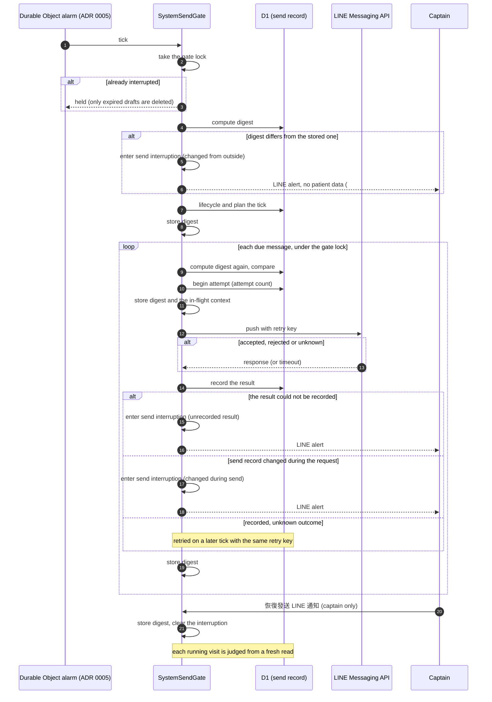

# A send interruption guards the send record

The system decides what to send next from its send record (`GLOSSARY.md`): the running visits and every message in `outbound_events`. If something outside the system's own steps changes that record, it can send a reminder twice or miss one. A restore that rolls `outbound_events` back to noon makes the 12:30 "near" message look unsent, and the next tick sends it again. Stopping visits does not protect against this, because a restore rolls the stopped state back too.

We decided on 2026-11-25, in the #142 grilling, to keep the send interruption with all three of its causes, even though no automatic interruption has ever fired on Staging or Production (every hold on record was set by hand). The captain had asked whether it is over-engineering, since an organizer who wants no messages can stop or delete the visit. The answer: an organizer's wishes and the send record are different needs. The causes are narrow enough not to fire falsely, so the automatic check costs little and is kept as a backstop for a captain who forgets to interrupt first.

1. **Manual.** The captain interrupts before a restore, a rollback, a migration that rewrites covered rows, or a manual SQL edit. The runbook is: interrupt, act, check, resume. It is a signed-in browser console call (`docs/HTTPS-SERVICE.md`), not a page button, because those operations are done on a computer anyway.
2. **The send record changed from outside.** After each of its own writes the gate stores a digest of the send record. Before each tick and each send it computes the digest again. A difference means something else wrote to it.
3. **A send result could not be recorded**, or the send record changed while a LINE request was in flight. LINE accepted the message, or may have, and the system cannot say so in its record.

A LINE request whose outcome is only unknown (a timeout, a 5xx) is retried with the same retry key and does not interrupt. Only the captain resumes sending. Resume never brings back a stopped visit, and every running visit is judged again from a fresh read.

## One send, step by step

## Considered options

- **Drop the automatic check, keep only the manual interruption and the runbook.** Rejected. Almost every real cause is the captain's own action, which the runbook covers, but a forgotten step on Production would duplicate or drop a family member's reminder with nothing to catch it. The check is already built and tested.
- **Let any organizer interrupt or resume.** Rejected. Resuming needs a check that only the captain can do. An organizer who wants no messages presses Stop on the visit card.
- **Interrupt on an unknown LINE outcome.** Rejected. The retry key covers it, and interrupting there would make interruptions frequent.

## Consequences

- No write outside the gate may change a column the digest covers. Checked on 2026-11-25: opt-in, invitation acceptance and draft edits stay out of the digest, so none can trigger a false interruption. `identity.set_friendship` writes a covered column and has no callers; wiring it up outside the gate would cause false interruptions.
- The check also runs in an environment that is not live, so a restore on Production interrupts it too.
- Every interruption must record its reason, since #160's banner shows it. As of 2026-11-25 the manual and unrecorded-result causes record none; #142's follow-up tickets fix this.
- Today only one captain and one running visit exist (#172), so Stop on the visit card is the phone-side answer to a single wrong visit. Revisit a phone-side interrupt when #140 allows several organizers.
